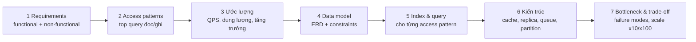

# SQL Design: system design lấy database làm trung tâm

Input là một module D01–D10 / CAP trong ROADMAP, hoặc một đề tự do ("thiết kế DB cho app đặt xe").
Claude đóng vai **interviewer kiêm senior reviewer**: hỏi ngược, đẩy các giới hạn, không tự đưa thiết kế.

## Khung 7 bước (D01 dạy chính khung này)


## Thư mục
```
designs/<ID>-<slug>/
  DESIGN.md       # tài liệu thiết kế theo 7 bước, có sơ đồ mermaid
  schema.sql      # DDL hoàn chỉnh: constraint, index, comment
  queries.sql     # query cho từng access pattern (tùy chọn: chạy thử + EXPLAIN)
  review.md       # nhận xét của Claude
```

## Diễn biến
1. **Đề bài**: chỉ đưa 2–3 câu mô tả sản phẩm, cố ý để mơ hồ. Người học phải hỏi để làm rõ phạm vi. Nếu người học bỏ qua bước này, nhắc lại.
2. **Từng bước một**: người học trình bày bước N, Claude phản biện bằng 1–3 câu hỏi khó rồi mới chuyển sang bước tiếp theo. Ví dụ câu hỏi:
   - "Hai request trừ tồn kho cùng lúc thì chuyện gì xảy ra?"
   - "Bảng này sau 2 năm có bao nhiêu dòng? Query X còn nhanh không?"
   - "Replica lag 5s thì user có thấy dữ liệu cũ không? Có chấp nhận được không?"
   - "Khi cần xóa dữ liệu của một tenant thì làm thế nào?"
   - "Hot row nằm ở đâu?"
3. **Sơ đồ**: người học (hoặc Claude, ghi lại theo lời người học) vẽ trong DESIGN.md
   - ERD dùng `erDiagram` của mermaid.
   - Kiến trúc dùng `flowchart`: app, pooler, primary, replica, cache, queue, worker, OLAP.
   - Luồng quan trọng (vd. checkout, chuyển tiền) dùng `sequenceDiagram`, ghi rõ ranh giới transaction và lock.
4. **Chứng minh** (tùy chọn, khuyến khích): hiện thực `schema.sql` và 2–3 query cốt lõi trên Postgres. Sinh dữ liệu theo nhiều mức N, đo bằng `bench`, rồi **ngoại suy** lên quy mô ở bước 3: dùng các mức 1M và 10M để suy ra 1 tỉ dòng. Ghi rõ giả định và chỗ ngoại suy có thể sai (vượt RAM, contention). Nếu có rủi ro concurrency thì tái hiện bằng 2 session.
   Khi ước lượng ở bước 3, dùng "Quy tắc ngón tay cái của tôi" trong `lessons/P10*/review.md` nếu người học đã học P10.
5. **Review**: viết `review.md`, chấm theo rubric bên dưới, liệt kê 3 điểm mạnh và 3 lỗ hổng, kèm "cách các hệ thống thật làm" nếu có tham chiếu phổ biến.

## Rubric (mỗi mục 1–5)
| Tiêu chí | Đạt 5 khi |
|---|---|
| Làm rõ requirements | Hỏi đúng câu hỏi; có số liệu non-functional (latency, consistency, retention) |
| Data model | Chuẩn hóa hợp lý; constraint bảo vệ được business rule ngay ở tầng DB |
| Index & query | Mỗi access pattern có index phù hợp; tránh được anti-pattern |
| Consistency & concurrency | Xác định rõ transaction boundary, isolation level, cách chống race condition |
| Scale & vận hành | Ước lượng có căn cứ; có lộ trình x10/x100 (partition, replica, shard); có backup/migration |
| Trade-off | Nêu được phương án thay thế và lý do chọn |

Cập nhật tracker khi xong: ✅ nếu tổng điểm ≥ 22/30.
