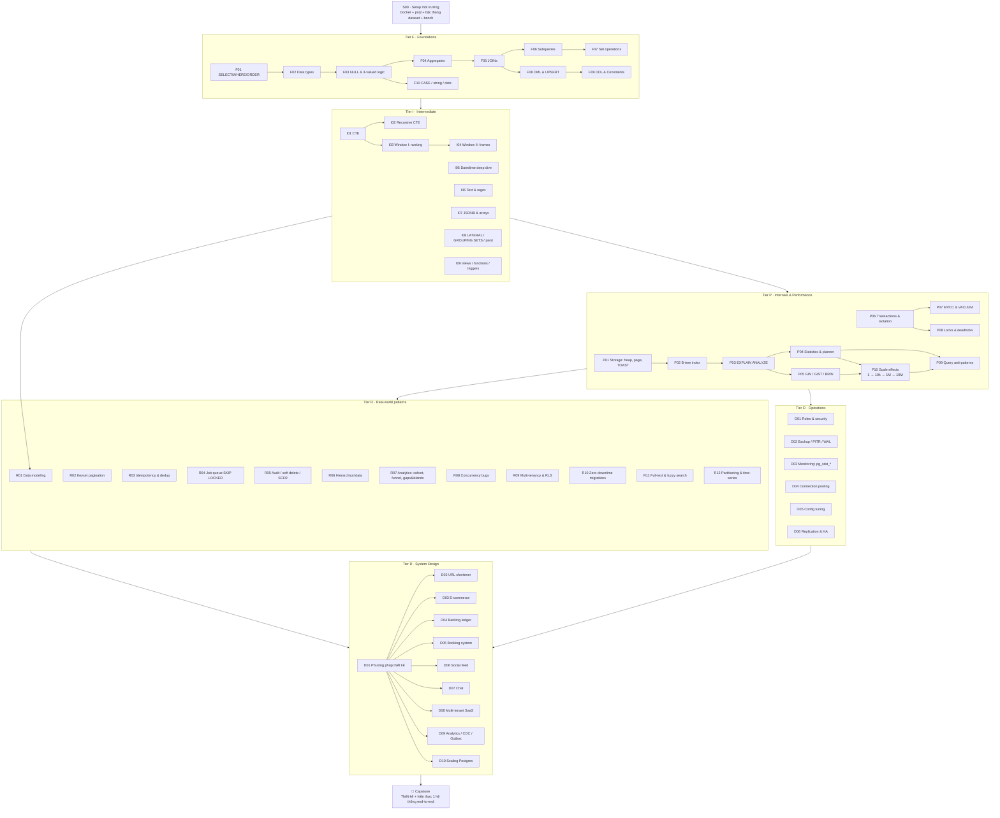
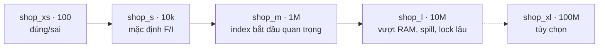
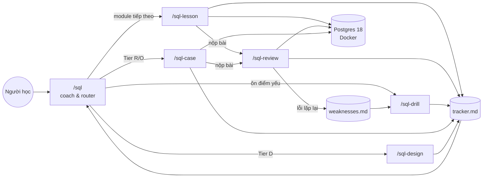
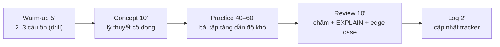

# Lộ trình SQL / PostgreSQL

> Nguồn sự thật cho **module ID**. Các skill đọc file này để biết nội dung từng buổi.
> Mỗi module ≈ 1 buổi (60–90 phút). Module lớn có thể chia 2 buổi (`F05a`, `F05b`).

## Sơ đồ tổng thể

Ghi chú phụ thuộc chéo quan trọng:
`P06–P08 → R04, R08` · `P02–P05 → R02, R11, R12` · `I03–I04 → R07` · `F09 + R01 → D*` · `O06 → D10` · `P10 → R10, R12, O05, D*`

## Trục quy mô (xuyên suốt mọi tier)

Học SQL không dừng ở chỗ query ra kết quả đúng. Cần biết thêm query còn chạy được ở quy mô nào, và lý do.

| Tier | Quy mô được dùng | Cách luyện |
|---|---|---|
| F | `xs` / `s` | Tập trung vào đúng/sai. Cuối mỗi buổi có thêm 1 câu "dự đoán ở 1M" để làm quen |
| I | `s` + `bench` | Mỗi lesson có ≥1 câu hỏi quy mô: dự đoán trước, sau đó chạy `bench` trên `s,m,l` |
| P | `m` / `l` | Mặc định đo trên dữ liệu lớn. P10 là module chuyên về hiệu ứng quy mô |
| R / O | `m` / `l` | Migration, partition, backup, vacuum: đo thời gian chạy và thời gian giữ lock theo quy mô |
| D | Ước lượng + `bench` | Ước lượng trên giấy, sau đó chứng minh bằng số đo thật ở `l` |

## Sơ đồ hệ thống skill

## Nhịp một buổi học chuẩn

---

## Danh mục module

Cột **Pass** = tiêu chí để đánh dấu ✅.

### S · Setup
| ID | Chủ đề | Nội dung chính | Pass |
|---|---|---|---|
| S00 | Môi trường | docker-compose Postgres 18, psql cơ bản (`\d`, `\dt`, `\x`, `\timing`), script sinh dữ liệu e-commerce (users, products, categories, orders, order_items, payments, events) có tham số N và seed cố định. Sinh bậc thang `shop_xs/s/m` (sinh `l` khi tới Tier P), DB `lab`, công cụ `bench/bench.sh` | `bench` chạy được 1 query trên `xs,s,m` và xuất bảng so sánh |

### F · Foundations
| ID | Chủ đề | Nội dung chính | Pass |
|---|---|---|---|
| F01 | SELECT cơ bản | SELECT, WHERE, ORDER BY, LIMIT/OFFSET, DISTINCT, alias, thứ tự thực thi logic | 8/10 bài, ≤2 hint |
| F02 | Data types | numeric vs float, text/varchar, boolean, timestamp vs timestamptz, uuid, cast `::`, overflow & làm tròn | 8/10 |
| F03 | NULL | three-valued logic, COALESCE, NULLIF, `IS DISTINCT FROM`, NULL trong ORDER BY / aggregate | 8/10 |
| F04 | Aggregates | GROUP BY, HAVING, COUNT(*) vs COUNT(col), `FILTER (WHERE)`, string_agg/array_agg | 8/10 |
| F05 | JOINs | INNER/LEFT/RIGHT/FULL/CROSS, self join, semi/anti join, bẫy nhân dòng (fan-out) | 8/10 |
| F06 | Subqueries | scalar, IN, EXISTS, correlated, bẫy `NOT IN` với NULL | 8/10 |
| F07 | Set operations | UNION vs UNION ALL, INTERSECT, EXCEPT, so sánh 2 tập dữ liệu | 8/10 |
| F08 | DML | INSERT…SELECT, UPDATE…FROM, DELETE…USING, RETURNING, `ON CONFLICT`, MERGE | 8/10 |
| F09 | DDL & constraints | CREATE/ALTER TABLE, PK/FK/UNIQUE/CHECK/NOT NULL, identity, ON DELETE, generated columns | Thiết kế được schema có ràng buộc đúng |
| F10 | Biểu thức | CASE, hàm string/date cơ bản, format số/ngày | 8/10 |

### I · Intermediate
| ID | Chủ đề | Nội dung chính | Pass |
|---|---|---|---|
| I01 | CTE | WITH, chia nhỏ query, `MATERIALIZED`/`NOT MATERIALIZED`, data-modifying CTE | 8/10 |
| I02 | Recursive CTE | cây danh mục, org chart, đường đi đồ thị, chống vòng lặp, sinh chuỗi | 6/8 |
| I03 | Window I | ROW_NUMBER, RANK, DENSE_RANK, NTILE, PARTITION BY, top-N mỗi nhóm | 8/10 |
| I04 | Window II | LAG/LEAD, running total, moving average, frame ROWS/RANGE/GROUPS, FIRST/LAST_VALUE | 8/10 |
| I05 | Date/time | time zone, date_trunc, interval, generate_series, lấp khoảng trống ngày | 8/10 |
| I06 | Text | LIKE/ILIKE, regex (`~`, regexp_*), split, string_agg, collation | 8/10 |
| I07 | JSONB & arrays | `->`, `->>`, `@>`, `?`, jsonb_path_query, jsonb_agg, unnest, array ops | 8/10 |
| I08 | Nâng cao | LATERAL, GROUPING SETS/ROLLUP/CUBE, pivot bằng FILTER, crosstab | 6/8 |
| I09 | Đối tượng DB | view, materialized view, function SQL/PL/pgSQL, trigger cơ bản | 6/8 |

### P · Internals & Performance (mặc định `shop_m`, thí nghiệm trên `shop_l`)
| ID | Chủ đề | Nội dung chính | Pass |
|---|---|---|---|
| P01 | Storage | heap, page 8KB, tuple header, ctid, TOAST, fillfactor, `pg_relation_size` | Giải thích được bằng số liệu thật |
| P02 | B-tree index | composite & thứ tự cột, covering `INCLUDE`, partial, expression index, index-only scan | Tối ưu 5 query chậm |
| P03 | EXPLAIN | đọc plan, Seq/Index/Bitmap scan, Nested Loop/Hash/Merge join, BUFFERS, cost vs actual | Đọc đúng 5 plan |
| P04 | Planner | ANALYZE, pg_stats, selectivity, ước lượng lệch, extended statistics | Sửa 3 plan sai do stats |
| P05 | Index đặc biệt | GIN (jsonb, trigram, FTS), GiST, BRIN, khi nào KHÔNG nên index | Chọn đúng loại index cho 6 tình huống |
| P06 | Transactions | ACID, isolation levels, anomalies (dirty, non-repeatable, phantom, write skew), SERIALIZABLE retry | Tái hiện được 3 anomaly bằng 2 session |
| P07 | MVCC & VACUUM | xmin/xmax, dead tuples, autovacuum, bloat, HOT update, XID wraparound | Đo & giải thích bloat |
| P08 | Locks | lock mode, `FOR UPDATE/SHARE/NO KEY UPDATE`, deadlock, lock queue khi ALTER, advisory lock, `lock_timeout` | Tái hiện & sửa 1 deadlock |
| P09 | Anti-patterns | N+1, OFFSET lớn, hàm bọc cột index, OR, implicit cast, `SELECT *`, `COUNT(*)` chậm | Refactor 8 query |
| P10 | Scale effects (2 buổi: P10a, P10b) | **P10a · Đọc:** điểm planner đổi từ Seq sang Index/Bitmap scan (selectivity × số dòng); join đổi từ Nested Loop sang Hash/Merge; sort/hash tràn ra đĩa khi vượt `work_mem`; bảng/index vượt `shared_buffers` (`pg_buffercache`, cache hit ratio); `COUNT(*)`, `ORDER BY` không có index, OFFSET sâu; độ phức tạp O(n) so với O(log n) đo thực tế. **P10b · Ghi & vận hành:** INSERT từng dòng, INSERT theo batch và `COPY`; chi phí index khi ghi (write amplification); thời gian `CREATE INDEX` / `CONCURRENTLY`; `ALTER TABLE` rewrite và thời gian giữ lock; `UPDATE` hàng loạt gây bloat; thời gian VACUUM/ANALYZE; dung lượng bảng + index + TOAST theo N | Mỗi thí nghiệm có dự đoán trước. Dự đoán đúng xu hướng ≥ 70%. Giải thích được mọi điểm gãy bằng số đo từ `bench` |

### R · Real-world patterns
| ID | Chủ đề | Nội dung chính | Pass |
|---|---|---|---|
| R01 | Data modeling | ERD, 1NF→BCNF, khi nào denormalize, naming convention, khóa tự nhiên vs surrogate | Model 1 domain có review |
| R02 | Pagination | keyset/cursor pagination, sort ổn định, so sánh với OFFSET | Benchmark 2 cách |
| R03 | Idempotency & dedup | upsert, idempotency key, xóa trùng giữ bản mới nhất, unique cho business rule | 6/8 |
| R04 | Job queue | `FOR UPDATE SKIP LOCKED`, retry/backoff, LISTEN/NOTIFY, so sánh với broker ngoài | Queue chạy đúng với nhiều worker |
| R05 | Lịch sử dữ liệu | audit log bằng trigger, soft delete, temporal table, SCD type 2 | 6/8 |
| R06 | Dữ liệu cây | adjacency list, ltree, closure table, nested set — trade-off | So sánh 3 cách |
| R07 | Analytics SQL | cohort retention, funnel, gaps & islands, sessionization, percentile | 6/8 |
| R08 | Concurrency bugs | lost update, oversell tồn kho, double booking (exclusion constraint), optimistic locking | Tái hiện & sửa 3 bug |
| R09 | Multi-tenancy | shared table + tenant_id, schema-per-tenant, Row-Level Security | RLS chặn đúng truy cập chéo |
| R10 | Migrations | add column/NOT NULL an toàn, backfill theo batch, `CREATE INDEX CONCURRENTLY`, expand/contract | Kế hoạch migration không downtime |
| R11 | Search | tsvector/tsquery, ranking, pg_trgm fuzzy, unaccent (tiếng Việt) | Search đúng + có index |
| R12 | Bảng lớn | partitioning range/list/hash, partition pruning, retention, time-series rollup | Partition + pruning hoạt động |

### O · Operations
| ID | Chủ đề | Nội dung chính | Pass |
|---|---|---|---|
| O01 | Security | role, GRANT/REVOKE, default privileges, least privilege, SQL injection & prepared statement | Thiết lập role cho 1 app |
| O02 | Backup | pg_dump/pg_restore, WAL, PITR, kiểm thử restore | Restore thành công |
| O03 | Monitoring | pg_stat_statements, pg_stat_activity, pg_locks, auto_explain, log_min_duration_statement | Tìm top 5 query tệ nhất |
| O04 | Connections | chi phí connection, max_connections, PgBouncer session/transaction mode | Giải thích & cấu hình |
| O05 | Tuning | shared_buffers, work_mem, effective_cache_size, checkpoint, random_page_cost | Đo trước/sau |
| O06 | Replication & HA | streaming vs logical replication, replica lag, read-your-writes, failover (Patroni — khái niệm) | Dựng 1 replica bằng Docker |

### D · System Design
| ID | Chủ đề | Trọng tâm | Pass |
|---|---|---|---|
| D01 | Phương pháp | requirements → access patterns → ước lượng tải → schema → index → bottleneck → scale | Áp dụng được checklist |
| D02 | URL shortener | sinh ID, hot read, cache, analytics click | Bản thiết kế + review |
| D03 | E-commerce | đơn hàng, tồn kho, thanh toán, trạng thái đơn (state machine) | 〃 |
| D04 | Banking ledger | double-entry, số dư, chuyển tiền idempotent, đối soát | 〃 |
| D05 | Booking | giữ chỗ tạm, hết hạn, chống double booking | 〃 |
| D06 | Social feed | follow graph, fan-out on write/read, counter hot row | 〃 |
| D07 | Chat | lưu tin nhắn, unread count, phân trang lịch sử | 〃 |
| D08 | Multi-tenant SaaS | isolation, noisy neighbor, migrate tenant lớn | 〃 |
| D09 | Data pipeline | OLTP vs OLAP, outbox pattern, CDC, materialized aggregates | 〃 |
| D10 | Scaling Postgres | replica, cache, partition, sharding (Citus), khi nào rời Postgres | 〃 |
| CAP | Capstone | chọn 1 đề D*, hiện thực schema + seed + query chính + benchmark | Demo + review |
