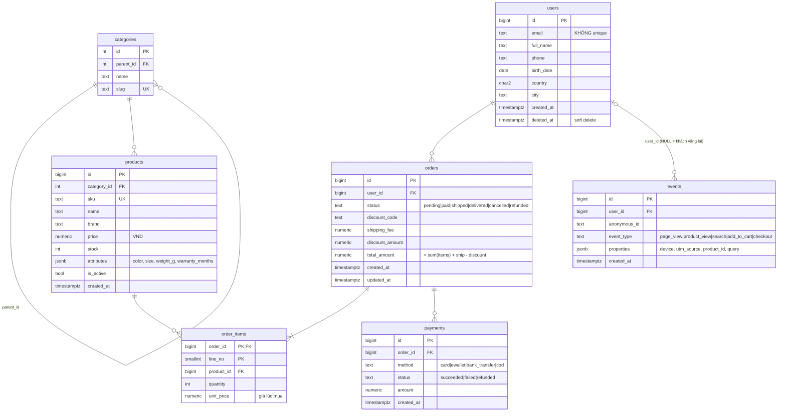

# Dataset `shop`

Dữ liệu e-commerce giả lập kiểu Việt Nam: tên người Việt, giá VND, giờ mua hàng theo giờ VN.
Có 5 mức với cùng schema và cùng seed, chỉ khác quy mô.

```bash
datasets/shop/build.sh <xs|s|m|l|xl>    # sinh lại từ đầu (DROP + CREATE)
```

## ERD



**Index:** chỉ có PK và UNIQUE (`products.sku`, `categories.slug`). Không có index trên cột FK, cũng không có index phụ nào. Đây là chủ ý.

## Tỉ lệ theo N (N = số đơn hàng)

| Bảng | Số dòng | Ghi chú |
|---|---|---|
| orders | N | |
| order_items | ≈ 2.54 N | 1–5 dòng/đơn |
| payments | ≈ 1.04 N | có lần thất bại, hoàn tiền |
| events | ≈ 3.24 N | 1–8 event/phiên, N phiên |
| users | max(20, N/10) | |
| products | max(50, min(N/50, 20 000)) | |
| categories | 42 | cây 3 tầng, 8 gốc |

## Dung lượng thực đo (Postgres 18, máy này)

| DB | N | Tổng | Thời gian sinh |
|---|---|---|---|
| shop_xs | 100 | 9 MB | 1s |
| shop_s | 10 000 | 18 MB | 2s |
| shop_m | 1 000 000 | 908 MB | 53s |
| shop_l | 10 000 000 | _chưa sinh (ước tính ~9 GB, ~10 phút)_ | |

## Phân phối (giống thực tế, có chủ đích)

- **Thời gian:** đơn từ 2024-01 đến 2026-09-30. Cửa hàng tăng trưởng nhanh nên tháng sau nhiều đơn hơn tháng trước.
- **Ngày sale:** 11/11, 12/12 và 9/9 (năm 2026) là các ngày đỉnh. Tháng 11–12 cũng cao hơn các tháng xung quanh.
- **Giờ:** khoảng 82% đơn được đặt từ 8h–23h **giờ Việt Nam**, nhưng server lưu UTC (`timezone=UTC`).
- **Khách "whale":** 1% khách tạo khoảng 21% số đơn. User id càng nhỏ thì đăng ký càng sớm và mua càng nhiều.
- **Sản phẩm hot:** product id nhỏ được mua nhiều hơn hẳn.
- **Giá theo ngành:** Điện tử trung bình khoảng 6 triệu, Sách khoảng 240 nghìn.
- **Trạng thái đơn:** khoảng 84% delivered, 8.5% cancelled, 4% refunded. Đơn càng mới càng hay ở trạng thái pending/paid/shipped.
- **Event:** không lưu `session_id`. Muốn phân phiên phải tự suy ra từ khoảng cách thời gian.
- `order id`, `payment id`, `event id` tăng theo thời gian, đúng như bảng append-only ngoài đời.

Dữ liệu có **lỗi cài sẵn** để luyện làm sạch và xử lý tình huống thực tế. Danh sách chi tiết nằm ở `DIRTY.md` ⚠️ spoiler: nên tự phát hiện trước khi đọc.
