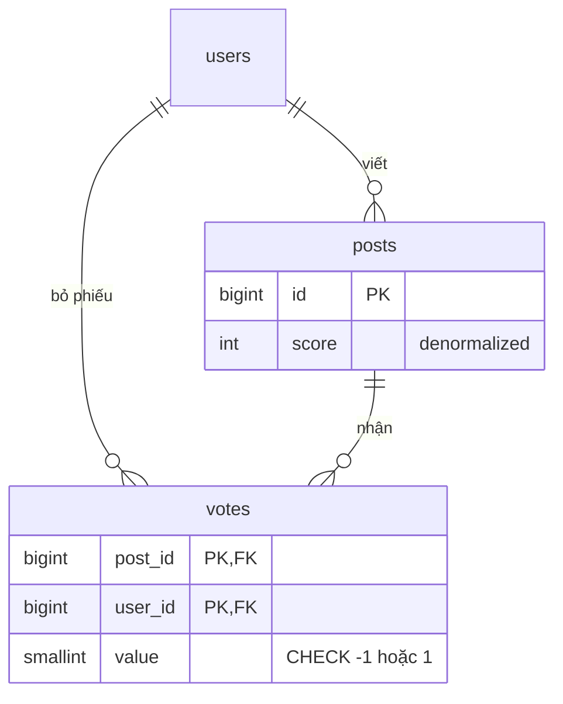

# D01 · Thiết kế tham chiếu (⚠️ spoiler)

Số đo bên dưới chạy trên Postgres 18.6 (Docker), `lab.d01` với seed trong `queries.sql` (100k bài, ~100k vote). Ngoại suy lên 1 năm là **giả định**, không đo.

## 1. Requirements
- Functional: vote up/down, mỗi người 1 phiếu/bài, đổi/rút phiếu; trang chủ top bài 24h; trang bài hiện vote của tôi; lịch sử vote của user.
- Non-functional: score trễ ≤ vài giây; không đếm thừa phiếu; giữ vote vĩnh viễn; 50k user, 5k bài/ngày.

## 2. Access patterns
| # | Query | Loại | Tần suất |
|---|---|---|---|
| A1 | vote / đổi vote | ghi | ~200k/ngày |
| A2 | top 20 bài 24h theo score | đọc | mỗi lượt vào trang chủ, cao nhất |
| A3 | trang bài + vote của tôi | đọc | cao |
| A4 | lịch sử vote của user | đọc | thấp |

Tỉ lệ đọc:ghi ≈ 50:1 (giả định: 10M page view/ngày). Vì vậy đọc A2/A3 phải rẻ, ghi A1 được phép tốn thêm một UPDATE.

## 3. Ước lượng
- Vote/ngày = 5k bài × 40 = **200k** → trung bình 2.3/s, đỉnh ×10 ≈ **25/s**. Postgres đơn lẻ xử lý dễ.
- Dòng/năm = 200k × 365 ≈ **73M**.
- Bytes/dòng: đo `pg_total_relation_size('votes')/count(*)` = **~116 B** (heap + PK + index user). Mẫu nhỏ nên hơi lạc quan/bi quan tùy fillfactor; lấy 120 B → 73M × 120 B ≈ **8.8 GB/năm**. Còn vừa 1 máy; sau 3–4 năm cần partition theo `created_at` hoặc archive.
- `posts`: 1.8M dòng/năm × ~240 B (đo 24 MB/100k kèm 2 index) ≈ 430 MB.

## 4. Data model

- PK `(post_id, user_id)` chính là rule "một người một phiếu". Không cần `id` surrogate.
- `score` denormalized vì A2 xếp hạng theo nó; `count/sum` trên `votes` mỗi lần load trang chủ là không thể.
- Xóa bài → `ON DELETE CASCADE` (đúng yêu cầu). Xóa user: không cascade; ẩn danh hóa user (giữ `users.id`).

## 5. Index & query
Xem `queries.sql`, plan thực đo:
- A1: `INSERT … ON CONFLICT DO UPDATE … RETURNING old.value, new.value` + `UPDATE posts SET score = score + delta` trong **một câu lệnh** (CTE ghi). Retry cho delta 0. `old`/`new` trong RETURNING là tính năng Postgres 18 (đã chạy trên 18.6); trên bản cũ thì `SELECT … FOR UPDATE` dòng vote cũ trước.
- A2: `posts_created_idx (created_at DESC)` → Bitmap Index Scan rồi top-N heapsort; đo **733 buffers** để duyệt cửa sổ 24h (~3.9k bài sau lọc) rồi lấy 20. Tăng theo số bài/ngày, không theo tổng số bài.
- A3: 2 Index Scan theo PK, **9 buffers**.
- A4: `votes_user_idx (user_id, created_at DESC)`, 13 buffers cho 11 vote.

```mermaid
sequenceDiagram
    participant C as Client
    participant A as App
    participant P as Postgres
    C->>A: POST /vote (post, value)
    A->>P: BEGIN; WITH v AS (upsert votes), u AS (UPDATE posts) ...; COMMIT
    Note over P: lock dòng votes (post,user) rồi dòng posts(id)
    P-->>A: delta
    A-->>C: 200 (retry an toàn: delta=0)
```

## 6. Kiến trúc
Một primary + 1 replica đọc; trang chủ cache 5–10 giây (đủ cho "trễ vài giây"). Không cần queue ở 25 vote/s. Khi bài viral, đưa vote vào Redis/queue rồi gom batch ghi (xem B7).

## 7. Bottleneck & trade-off
| Vấn đề | Phát hiện | Cách xử |
|---|---|---|
| **Hot row** `posts.score`: mọi vote cùng bài xếp hàng chờ row lock | `pg_stat_activity` wait `transactionid`; latency vote bài viral tăng | (a) gom batch 1s, (b) bảng `post_score_shards` N dòng/bài rồi sum, (c) bỏ denormalize và cache |
| `score` lệch | Query đối soát (queries.sql §6) cho 0 bài lệch | Chạy định kỳ; sửa bằng UPDATE từ `sum(votes)` |
| `votes` 73M+/năm | kích thước, vacuum lâu | Partition theo tháng (vote cũ ít đổi), archive |
| x10 người dùng | A2 duyệt cửa sổ 24h gấp 10 | Cache trang chủ; hoặc bảng `hot_posts` được làm mới mỗi phút |

**Phương án thay thế cho `score`:**
| Phương án | Đọc A2 | Ghi A1 | Rủi ro |
|---|---|---|---|
| Tính khi đọc (`sum` join) | chậm, tăng theo vote | rẻ | không dùng được ở 100k+ bài |
| Denormalize trong `posts` (chọn) | rẻ | thêm 1 UPDATE, hot row | lệch nếu đường ghi lách |
| Cache/Redis counter | rẻ nhất | rẻ | mất đồng bộ khi cache chết |

Chọn denormalize vì ghi 25/s đỉnh không chạm giới hạn row lock; nêu rõ điểm vỡ là bài viral.
