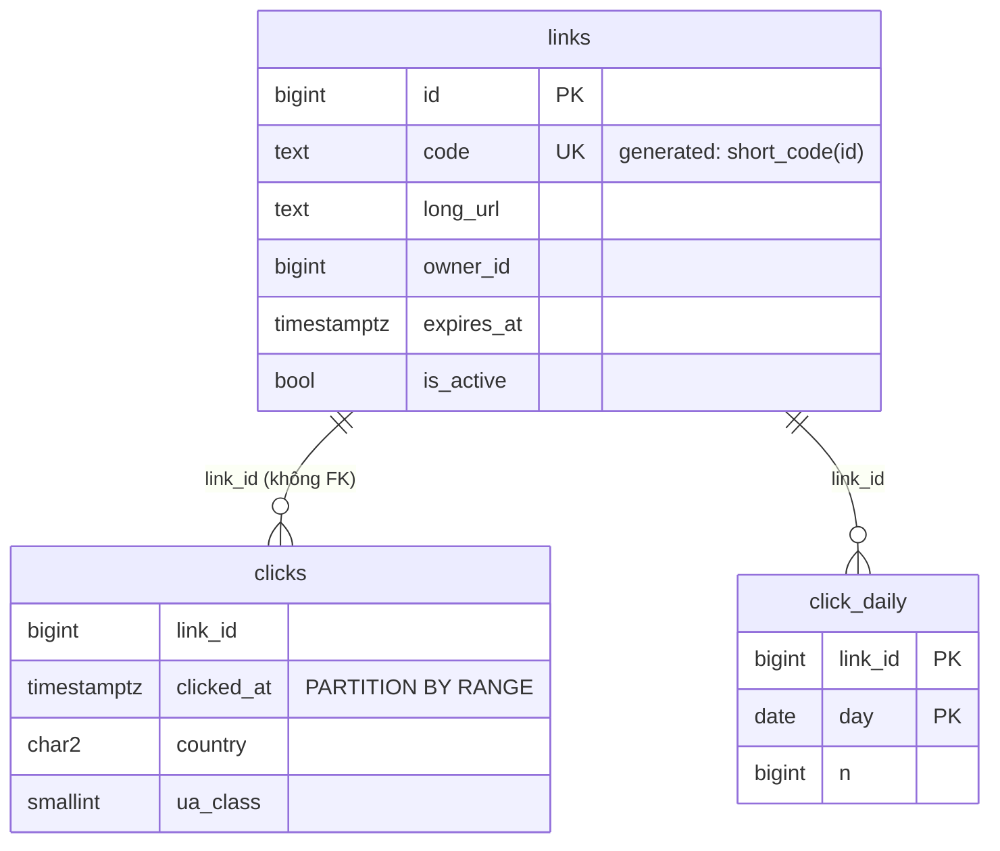
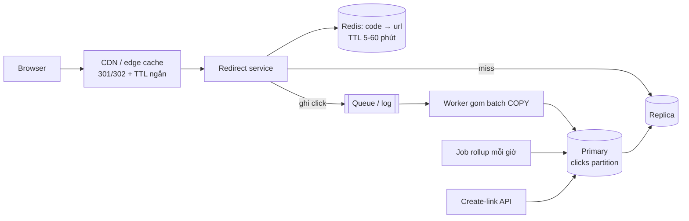

# D02 · Thiết kế tham chiếu (⚠️ spoiler)

Số đo: Postgres 18.6 Docker, `lab.d02` (200k link, 1M click). Ngoại suy là giả định.

## 1. Requirements
Tạo link (custom alias tùy chọn); redirect p99 < 50 ms; hết hạn/vô hiệu hóa ≤ 1 phút; thống kê click theo ngày/quốc gia/thiết bị; chi tiết 90 ngày, tổng hợp vĩnh viễn.

## 2. Access patterns
| # | Query | Loại | Tải |
|---|---|---|---|
| A1 | tạo link | ghi | ~4/s |
| A2 | redirect `code → long_url` | đọc | ~385/s TB, ~4k/s đỉnh |
| A3 | ghi click | ghi | cùng tần suất A2 |
| A4 | dashboard 1 link × 30 ngày | đọc | thấp, nhưng không được quét `clicks` |
| A5 | liệt kê link của owner | đọc | thấp |

## 3. Ước lượng
- Redirect: 1 tỉ/tháng ÷ 2.6M giây ≈ **385/s**; đỉnh ×10 ≈ **4k/s**.
- Link: 10M/tháng → 120M/năm × **179 B/dòng** (đo, gồm PK + UNIQUE code) ≈ **21 GB/năm**. Index `code` ~ 40–50% số đó → vừa RAM 1 máy lớn.
- Không gian code: 62⁷ ≈ 3.5×10¹² ≫ 120M/năm ⇒ dùng ~0.003%/năm.
- Click thô: 1 tỉ/tháng × **102 B** (đo, gồm index) ≈ **100 GB/tháng**, 90 ngày ≈ **300 GB**. Ghi 385–4k dòng/s vẫn trong khả năng 1 primary, nhưng dung lượng + vacuum là vấn đề ⇒ partition + rollup (hoặc sampling bot).

## 4. Data model

Sinh code: `id` từ sequence → `(id × 1000000007) mod 62⁷` → base62 7 ký tự. Phép nhân với số nguyên tố cùng nhau với 62⁷ là **song ánh** ⇒ không va chạm, không cần retry, nhìn không thấy thứ tự (queries.sql §1 ASSERT 200k code khác nhau, không tuần tự). Điểm yếu: **không bí mật** (hằng số nằm trong code; đây là obfuscation, không phải bảo mật). Nếu cần bảo mật thật: random 7 ký tự + `INSERT … ON CONFLICT DO NOTHING` + retry (xác suất va chạm ở 120M link ≈ 120M/3.5T ≈ 3.4×10⁻⁵ mỗi lần chèn).
Custom alias: ghi cùng cột `code` (bỏ generated, hoặc bảng `aliases` riêng) với namespace khác (vd. dài ≠ 7 hoặc chứa `-`) để không đụng code sinh tự động.

## 5. Index & query
- A2: `UNIQUE (code)` (COLLATE "C"), plan **Index Scan, 4 buffers** (đo). Điều kiện `is_active`/`expires_at` kiểm trên dòng đã lấy.
- A3: `INSERT` vào partition tháng hiện tại, 1 index `(link_id, clicked_at)`.
- A4: đọc `click_daily` bằng PK (đo 7–10 buffers), không đụng `clicks`.
- Rollup (`rollup_day`) **ghi đè** `n = EXCLUDED.n` cho ngày đã đóng ⇒ chạy lại bao nhiêu lần cũng đúng (ASSERT trong queries.sql §4). Nếu cộng dồn `n = n + x` thì job chạy lại 2 lần sẽ đếm gấp đôi.
- Partition pruning: truy vấn 1 ngày chỉ quét 1 partition (ASSERT §6).
- Retention: `DETACH PARTITION` + `DROP TABLE` (§7), tức thời, không bloat; `DELETE` 300 GB là bất khả thi.

## 6. Kiến trúc

- Cache: phân phối truy cập kiểu Zipf ⇒ một tập nhỏ link chiếm đa số lượt ⇒ hit-rate cao; DB chỉ nhận phần miss (với hit 95% còn ~200/s đỉnh: **giả định, cần đo trên traffic thật**).
- Dùng 302 (hoặc 301 với `Cache-Control` ngắn) nếu cần đếm click; 301 vĩnh viễn làm trình duyệt bỏ qua server ⇒ mất số đếm.
- Vô hiệu hóa: xóa key cache + dùng TTL ngắn làm lưới an toàn (đáp ứng ≤ 1 phút).
- Click qua queue + batch `COPY`: giảm số transaction, chịu được burst; mất vài giây dữ liệu khi sự cố là chấp nhận được (yêu cầu cho phép sai số nhỏ).

## 7. Bottleneck & trade-off
| Vấn đề | Cách xử |
|---|---|
| Thundering herd khi cache lạnh | single-flight/lock theo key, TTL ngẫu nhiên, warm-up |
| Link viral → 1 key nóng | cache local trong process + CDN; counter click ở Redis rồi flush |
| `clicks` 300 GB | partition tháng, index tối thiểu, rollup; cân nhắc store cột (ClickHouse) khi cần phân tích tự do ⇒ xem D09/D10 |
| x10 | shard `links` theo hash(code); redirect biết shard từ code nên 1 hop; `owner_id` listing phải scatter-gather hoặc bảng phụ |
| Id sequence thành điểm nghẽn khi nhiều region | cấp phát dải ID cho từng app server (block 1000) |

| Cách sinh code | Va chạm | Đoán thứ tự | Ghi chú |
|---|---|---|---|
| Sequence + song ánh (chọn) | không | khó (không bí mật) | phụ thuộc DB, đơn giản |
| Random + retry | có, hiếm | không thể | cần UNIQUE + vòng retry |
| Hash(URL) cắt 7 ký tự | có, tăng theo N | — | cùng URL cho cùng code (dedupe) nhưng khách khác nhau muốn thống kê riêng ⇒ sai yêu cầu |
