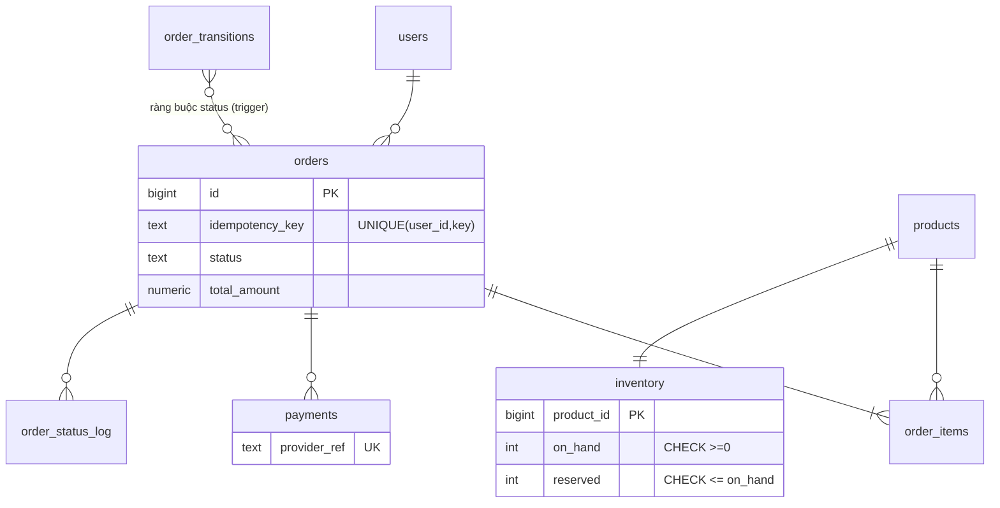
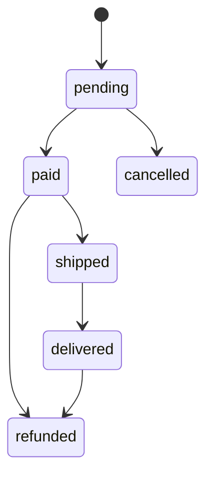

# D03 · Thiết kế tham chiếu (⚠️ spoiler)

Số đo: Postgres 18.6 Docker, `lab.d03` (300k đơn, 600k dòng hàng). Thí nghiệm concurrency chạy bằng `concurrency/run.sh` (pgbench, 50 client × 40 giao dịch trên 1 dòng, tồn đầu 100). Máy cloud ≠ máy người học: tin vào *kết luận đúng/sai*, không tin tuyệt đối vào thời gian.

## 1. Requirements
Đặt đơn nhiều dòng; giữ chỗ 15 phút; thanh toán qua webhook (lặp, trễ); trừ kho thật khi paid; hủy trước giao, hoàn tiền sau giao; flash sale 5k đơn/60s; giữ đơn 10 năm.

## 2. Access patterns
| # | Query | Loại |
|---|---|---|
| A1 | đặt đơn (giữ chỗ + insert đơn/dòng) | ghi, nóng |
| A2 | webhook thanh toán | ghi, nóng |
| A3 | quét đơn pending quá hạn, trả giữ chỗ | ghi nền |
| A4 | lịch sử đơn của user | đọc |
| A5 | đối soát | đọc nền |

## 3. Ước lượng
- Thường ngày 50k đơn/ngày ≈ 0.6 đơn/s. Flash sale: 5k/60s ≈ **83 đơn/s**, mỗi đơn ~3–6 dòng ghi ⇒ vài trăm ghi/s: Postgres đơn lẻ làm tốt. **Vấn đề không phải thông lượng tổng mà là tranh chấp trên vài dòng tồn kho.**
- 10 năm × 50k × 365 = **182M đơn**; đo `orders` 58 MB/300k = ~193 B/đơn (gồm 3 index), `order_items` ~110 B/dòng ⇒ ~35 GB `orders` + ~120 GB items (2.5 dòng/đơn) ⇒ cần partition/archive theo năm.
- Hot row: các giao dịch cùng dòng xếp hàng theo row lock ⇒ thông lượng ≈ 1/(thời gian giữ lock). Giữ lock càng ngắn (transaction chỉ chứa UPDATE tồn kho + vài INSERT) càng tốt: **đẩy việc chậm (gọi cổng thanh toán, gửi email) ra ngoài transaction**.

## 4. Data model


- `inventory` tách riêng, `fillfactor 70` để UPDATE thành HOT, bớt bloat; `products` ít đổi nên cache tốt.
- Tiền `numeric(·,0)` cho VND (không float). `unit_price` snapshot trong `order_items`.
- Transition nằm ở bảng + trigger: mọi service cùng bị ràng buộc; `order_status_log` là audit miễn phí. Đánh đổi: trigger làm chậm UPDATE status một chút; đơn giản hơn so với CHECK vì CHECK không thấy giá trị cũ.

## 5. Index & query
- Giữ chỗ: `UPDATE inventory SET reserved = reserved + n WHERE product_id = $1 AND on_hand - reserved >= n`; 0 dòng ⇒ hết hàng. **Điều kiện nằm trong UPDATE nên kiểm tra và ghi là một bước nguyên tử** (dưới Read Committed, transaction sau chờ row lock rồi đánh giá lại điều kiện trên bản mới nhất).
- Thí nghiệm (đo thật, tồn đầu 100, 50 client × 40 lần = 2000 yêu cầu):

| Cách | Bán ra | Tồn còn lại |
|---|---|---|
| Đọc `on_hand` rồi `UPDATE on_hand = :oh - 1` (naive) | **2000** | 41 |
| `UPDATE … WHERE on_hand >= 1` (safe) | **100** | 0 |

  Naive bán gấp 20 lần tồn kho (lost update + check-then-act). Số cụ thể thay đổi giữa các lần chạy; kết luận thì không.
- Nhiều dòng: khóa theo `ORDER BY product_id` (trong `place_order` và `FOR UPDATE ORDER BY` ở `confirm_payment`/`cancel_pending`) để hai đơn `{A,B}` và `{B,A}` không chờ vòng tròn. *Chưa chạy thí nghiệm deadlock có/không sắp thứ tự; đây là lập luận chuẩn, không phải số đo.*
- Idempotency đặt đơn: `UNIQUE (user_id, idempotency_key)` + `ON CONFLICT DO NOTHING` (queries.sql §1). Webhook: `UNIQUE (provider_ref)` (§3).
- Job hết hạn: partial index `orders_pending_idx` ⇒ Index Scan 1 buffer trên 300k đơn (đo, §4); không partial thì phải lọc cả bảng.
- A4: `orders_user_idx (user_id, created_at DESC)`: 18 buffers cho 15 đơn (§5).

```mermaid
sequenceDiagram
    participant U as Khách
    participant A as App
    participant P as Postgres
    participant G as Cổng thanh toán
    U->>A: checkout (idempotency_key)
    A->>P: place_order(): BEGIN; insert order; UPDATE inventory (theo thứ tự id); insert items; COMMIT
    A-->>U: order_id, hạn thanh toán 15'
    U->>G: thanh toán
    G->>A: webhook(provider_ref, amount)  %% có thể lặp
    A->>P: confirm_payment(): insert payments ON CONFLICT; pending->paid; on_hand/reserved -= q
    Note over A,G: KHÔNG gọi cổng trong transaction giữ lock tồn kho
```

## 6. Kiến trúc
Primary duy nhất cho luồng đặt đơn/webhook; replica cho lịch sử đơn (chấp nhận trễ, trừ trang "đơn vừa đặt" phải đọc primary: read-your-writes). Worker nền hủy đơn quá hạn mỗi phút (batch 100, `FOR UPDATE SKIP LOCKED`). Flash sale: thêm bước **giữ chỗ trước bằng token** ở Redis/queue để DB chỉ nhận lượng yêu cầu bằng đúng số tồn.

## 7. Bottleneck & trade-off
| Vấn đề | Xử lý |
|---|---|
| Hot row tồn kho sản phẩm hot | chia kho thành N bucket (`inventory_buckets`), chọn bucket ngẫu nhiên, hết bucket thì thử bucket khác; hoặc queue tuần tự theo sản phẩm |
| Webhook đến sau khi đơn đã hết hạn | `confirm_payment` ném lỗi ⇒ đưa vào hàng đợi hoàn tiền tự động (không âm thầm nuốt) |
| `orders` 182M dòng/10 năm | partition theo năm; tra theo user cần index local trên từng partition hoặc bảng `user_orders` phụ |
| Lệch `reserved` | đối soát (§7 queries.sql): `reserved` = Σ quantity đơn pending; chạy định kỳ |
| Bloat `inventory` | fillfactor + autovacuum ngưỡng thấp riêng cho bảng này |

| Cách chống oversell | Ưu | Nhược |
|---|---|---|
| `UPDATE … WHERE on_hand >= n` (chọn) | đơn giản, đúng, không cần lock thủ công | hot row giới hạn thông lượng 1 sản phẩm |
| `SELECT … FOR UPDATE` rồi UPDATE | dễ đọc | giữ lock lâu hơn, dễ deadlock, thêm round trip |
| SERIALIZABLE + retry | tổng quát | tỉ lệ retry cao ở hot row |
| Queue tuần tự theo sản phẩm | không contention | thêm hạ tầng, độ trễ |
| Redis token trước | chịu tải rất cao | hai nguồn sự thật, cần đối soát |
