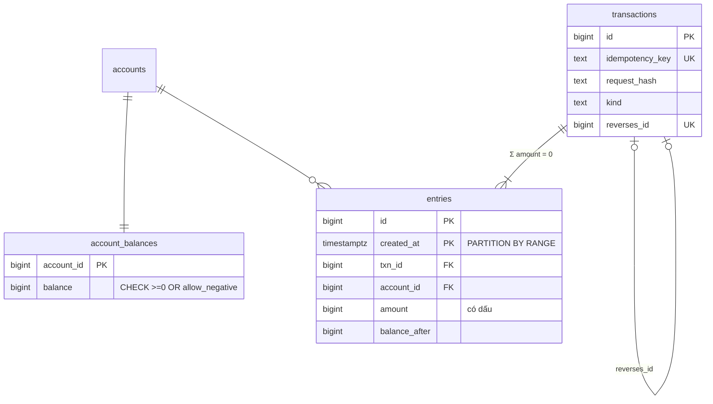
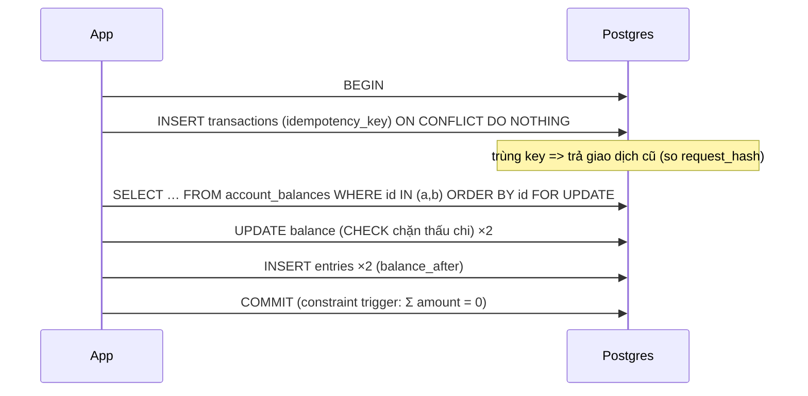

# D04 · Thiết kế tham chiếu (⚠️ spoiler)

Số đo: Postgres 18.6 Docker, `lab.d04` (50k tài khoản, 250k giao dịch, 500k entries). Thí nghiệm `concurrency/run.sh`: pgbench 20 client × 200 giao dịch chuyển chéo giữa 10 tài khoản. Máy cloud ≠ máy người học.

## 1. Requirements
Nạp/chuyển/rút; không thấu chi cho khách; hoàn tiền bằng bù trừ; số dư realtime; sao kê; đối soát hằng ngày; audit 10 năm.

## 2. Access patterns
| # | Query | Loại | Yêu cầu |
|---|---|---|---|
| A1 | chuyển tiền | ghi | idempotent, atomic |
| A2 | số dư hiện tại | đọc | p99 < 50 ms |
| A3 | sao kê, phân trang | đọc | 100 dòng/trang |
| A4 | số dư tại ngày T | đọc | không cộng dồn |
| A5 | đối soát | đọc nền | tìm lệch/thiếu/thừa |

## 3. Ước lượng
- 2M chuyển/ngày = 23/s TB, đỉnh ~500/s. Mỗi chuyển: 1 transaction, 1 dòng `transactions`, 2 `entries`, 2 UPDATE balance ⇒ vài nghìn ghi/s đỉnh: **lớn nhưng 1 primary vẫn làm được**; giới hạn thật là WAL/IO và hot account.
- Entries: 4M/ngày ⇒ **1.46 tỉ/năm**. Đo `entries` = **190 B/dòng** (heap + PK + 2 index) ⇒ **~280 GB/năm**, 10 năm ~2.8 TB ⇒ bắt buộc partition theo tháng và đưa tháng cũ ra lưu trữ (chiến lược giả định, chưa đo ở quy mô này).
- `transactions` 146 B/dòng ⇒ 2M × 365 × 146 ≈ 107 GB/năm. `account_balances` 103 B × 5M = ~0.5 GB, nằm gọn trong RAM.
- Đọc số dư: 1 index scan trên bảng 0.5 GB ⇒ vài buffers.

## 4. Data model

- Double-entry với **amount có dấu**: một cột, `Σ amount = 0` kiểm được bằng một `sum`. Hai cột debit/credit dễ sai dấu và gấp đôi chỗ để kiểm tra.
- `Σ = 0` ép bằng **constraint trigger DEFERRABLE INITIALLY DEFERRED**: kiểm lúc COMMIT khi cả hai chân đã được ghi (queries.sql §4). CHECK không làm được vì chỉ thấy một dòng.
- `entries` append-only: trigger chặn UPDATE/DELETE (§3). Ở production nên thêm `REVOKE UPDATE, DELETE` cho role ứng dụng.
- `balance_after` lưu số dư chạy ⇒ sao kê và "số dư tại T" không cần window/cộng dồn (§6, §7).
- Hoàn tiền: giao dịch `reversal` đảo dấu, trỏ `reverses_id`; **unique index trên `reverses_id`** chặn hoàn đôi (§5).
- Tiền: `bigint` đơn vị nhỏ nhất.

## 5. Index & query
- Số dư: `account_balances` PK. Sao kê: `entries_account_idx (account_id, created_at DESC, id DESC)` + keyset `(created_at, id) < (…)`. Plan đo (tài khoản mẫu có vài entry): Index Scan trên đúng partition tháng chứa dữ liệu, **6–8 buffers** cho 20 dòng/trang; partition khác chỉ Seq Scan bảng rỗng. Plan đo thấy `Sort` trên `Append`; với tài khoản nhiều entries mỗi tháng planner có thể chọn Merge Append: **chưa đo**.
- Số dư tại T: `ORDER BY created_at DESC, id DESC LIMIT 1` ⇒ 4 buffers, partition cũ `never executed` (§7).
- Đối soát (§8): FULL JOIN sổ cái ↔ sao kê ngân hàng, phát hiện đúng 3 loại chênh lệch (lệch tiền, thiếu, thừa).

## 6. Kiến trúc
Primary xử lý toàn bộ ghi; replica cho sao kê/báo cáo (sao kê "vừa chuyển xong" đọc primary). Job đối soát nội bộ hằng giờ: `balance = Σ entries` và `Σ balance = 0` (tiền không tự sinh). Job đối soát đối tác hằng ngày. Archive partition cũ sang kho lạnh sau 13 tháng.

## 7. Bottleneck & trade-off
**Thí nghiệm deadlock (đo thật):**

| Cách | Giao dịch xong | Thất bại | Ghi chú |
|---|---|---|---|
| `transfer` khóa theo `ORDER BY account_id` | 4000/4000 | 0 | invariants giữ nguyên |
| `transfer_naive` khóa theo thứ tự "người gửi trước" | 2614/4000 | **1386 (34.7%) deadlock** | mẫu nhỏ chạy lại cho 33.5%; bị chọn làm nạn nhân thì rollback |

Sau cả hai lần chạy: `Σ balance = 0`, 0 giao dịch không cân, 0 tài khoản lệch ⇒ **deadlock gây lỗi chứ không gây sai tiền** nhờ transaction + constraint. (Chạy `naive` chậm vì mỗi deadlock chờ `deadlock_timeout` 1 giây.)

| Vấn đề | Xử lý |
|---|---|
| Hot account (phí, nguồn tiền) | ghi phí vào bảng gộp theo lô; hoặc N sub-account chọn ngẫu nhiên; không đặt nó trong đường chuyển tiền thường |
| `entries` ~2.8 TB/10 năm | partition tháng, archive, index tối thiểu |
| Số dư lệch | job đối soát; sửa bằng **giao dịch điều chỉnh**, không UPDATE trực tiếp |
| Cần nhiều region | không dùng multi-primary cho sổ cái; shard theo account, giao dịch xuyên shard dùng saga + trạng thái trung gian |

| Cách giữ số dư | Ưu | Nhược |
|---|---|---|
| Tính khi đọc `Σ entries` | không thể lệch | O(số entries) mỗi lần đọc |
| `account_balances` cập nhật cùng transaction (chọn) | đọc O(1), đúng ngay | row lock trên mỗi tài khoản; hot account |
| Balance bất đồng bộ từ stream entries | ghi không tranh chấp | đọc trễ, khó chặn thấu chi |
| Snapshot theo ngày + cộng entries sau snapshot | đọc rẻ, kiểm chứng được | phức tạp, cần job snapshot |
