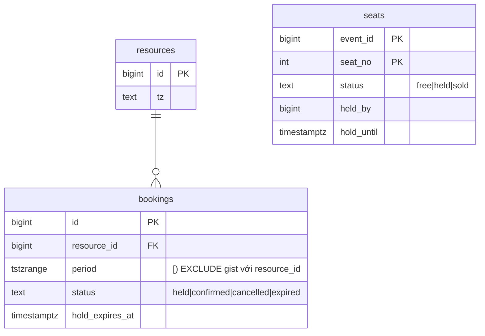
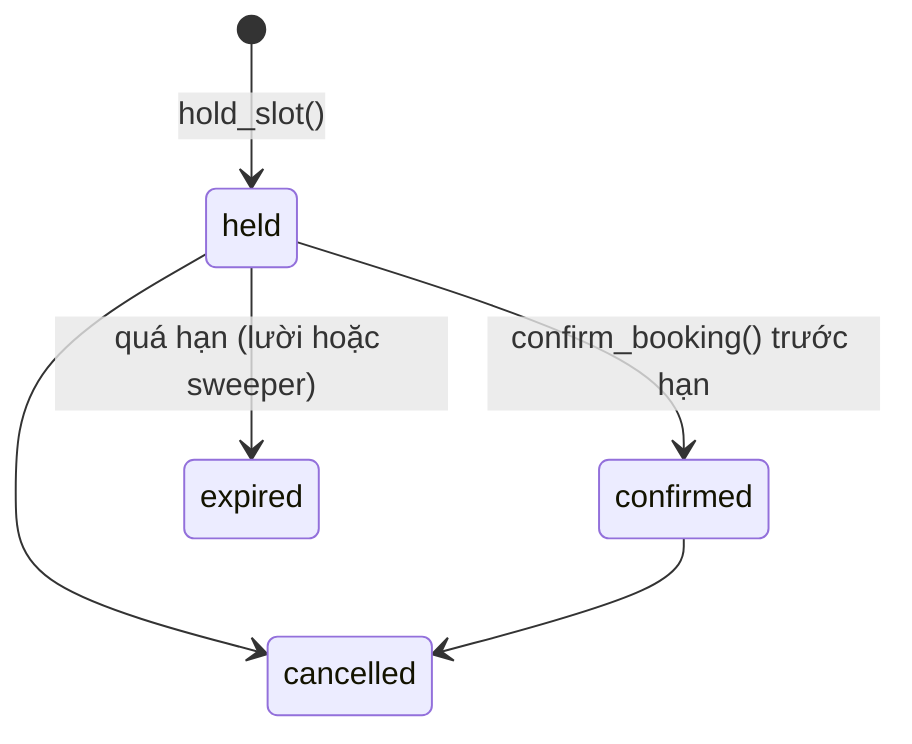
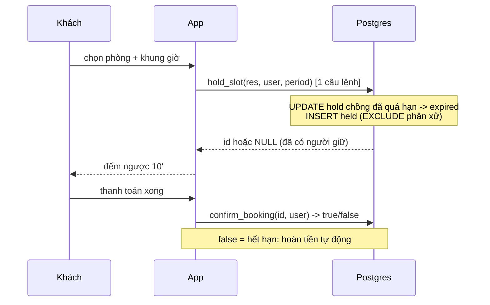

# D05 · Thiết kế tham chiếu (⚠️ spoiler)

Số đo: Postgres 18.6 Docker, `lab.d05` (2000 phòng, 800k booking, 500 ghế). Thí nghiệm `concurrency/run.sh`: pgbench 50 client, 10 giây, khung giờ đổi mỗi 50 ms nên mọi client tranh cùng một khung. Máy cloud ≠ máy người học.

## 1. Requirements
Đặt tài nguyên theo khoảng thời gian tùy ý (A) và ghế cố định (B); giữ chỗ 10'/5'; không double booking; hủy nhả ngay; đa múi giờ; liền kề hợp lệ.

## 2. Access patterns
| # | Query | Loại |
|---|---|---|
| A1 | hold khung giờ | ghi, nóng |
| A2 | confirm | ghi |
| A3 | tài nguyên X có trống khung này không / liệt kê tài nguyên trống | đọc, nóng nhất |
| A4 | dọn hold quá hạn | ghi nền |
| A5 | lịch sử của user | đọc |
| B1 | giữ ghế / mua ghế | ghi, cực nóng lúc mở bán |

## 3. Ước lượng
- 100k booking/ngày ≈ 1.2/s TB; mở bán 20k người/60s ≈ **333 hold/s** vào 500 ghế ⇒ 97.5% yêu cầu thất bại *nhanh* là đúng thiết kế.
- Dung lượng: `bookings` đo **215 B/dòng** (heap + 4 index) ⇒ 36.5M/năm ≈ **7.8 GB/năm**. Riêng GiST `no_double_booking` = **84 B/dòng** (67 MB/800k).
- Hold tồn tại ngắn nhưng để lại dòng `expired` (không xóa) hoặc xóa định kỳ: nếu mỗi booking thành công có 3 hold thất bại, bảng lớn gấp 4. Dọn dòng `expired` cũ bằng job, hoặc không ghi hold thất bại.

## 4. Data model

- **EXCLUDE USING gist (resource_id WITH =, period WITH &&) WHERE (status IN ('held','confirmed'))**: luật không chồng nằm trong DB. Điều kiện `WHERE` cho phép `cancelled`/`expired` nhả chỗ (queries.sql §1 đặt lại slot bị hủy thành công).
- `period` luôn `[)` (CHECK `lower_inc AND NOT upper_inc`): 10–12 và 12–14 liền kề hợp lệ.
- Ghế: mô hình đơn giản hơn, 1 dòng/ghế, chiếm bằng `UPDATE … WHERE status = 'free' OR (held AND hold_until <= now())`. Có thể dùng EXCLUDE nhưng tốn hơn mức cần thiết.
- Ranh giới ngày theo `tz` của tài nguyên: `timestamptz '2026-03-14 00:00 Asia/Ho_Chi_Minh'` ⇒ 13/03 17:00Z (queries.sql §5). Lưu mọi thứ bằng `timestamptz`.

## 5. Index & query
- **Hold hết hạn lười.** `now()` không dùng được trong constraint, nên một hold quá hạn chưa bị dọn vẫn khiến người sau bị `exclusion_violation`. `hold_slot` đánh dấu `expired` các hold quá hạn *chồng với khung đang đặt* trước khi chèn (§2). Sweeper `expire_holds` dọn phần còn lại bằng partial index `bookings_hold_exp_idx` (16 kB, §3) và `FOR UPDATE SKIP LOCKED`.
- **Kiểm tra trống** dùng chính GiST của EXCLUDE (không cần index riêng):
  - `resource_id = 1234::bigint`: Index Only Scan, cả hai điều kiện nằm trong Index Cond, **4 buffers**.
  - `resource_id = 1234` (literal int4): **BẪY**. Toán tử `int4 = int8` không thuộc operator class GiST của `btree_gist` cho `bigint`, nên `resource_id` thành `Filter`, index chỉ lọc theo `period` ⇒ Bitmap Heap Scan, **Rows Removed by Filter 1799, 1450 buffers**. Tức chậm hơn ~360× ở 2000 phòng, và tăng theo số phòng. ORM gửi tham số int4 sẽ dính. Luôn ép kiểu/khai báo tham số `bigint`.
  - Liệt kê phòng trống (200 phòng): Nested Loop Anti Join, 200 lần Index Only Scan, **808 buffers** (4 buffers/phòng).
- Kích thước index (800k booking): PK 17 MB, `no_double_booking` 67 MB, `bookings_user_idx` 9 MB.

## 6. Kiến trúc
Primary xử lý hold/confirm; tìm kiếm trống đọc được từ replica (chấp nhận trễ, **xác nhận cuối cùng luôn qua primary** vì chỉ constraint mới là sự thật). Sweeper chạy mỗi 30 giây, nhiều worker an toàn nhờ `SKIP LOCKED`. Mở bán lớn: waiting room/queue giảm số request chạm DB xuống mức nhà tổ chức chấp nhận.

## 7. Bottleneck & trade-off
**Thí nghiệm double booking (đo thật):** 50 client, 10 giây, mọi client tranh cùng khung giờ (đổi mỗi 50 ms).

| Cách | Giao dịch | Dòng đặt | Khung giờ khác nhau | Double booking |
|---|---|---|---|---|
| `hold_slot` + EXCLUDE | 18 658 | 112 | 112 | **0** |
| check-then-insert (`WHERE NOT EXISTS`) không constraint | 92 217 | 8 430 | 200 | **8 230** |

(Chạy lại cho số khác nhau; kết luận 0 vs hàng nghìn thì không đổi. Số khung tối đa là 200 = 10 giây / 50 ms; `safe` chỉ đặt được 112 khung vì nhiều lượt bị đẩy vào chờ khóa/deadlock, tức an toàn đổi lấy thông lượng.)

- **Deadlock giữa hai hold chồng nhau.** Mỗi bên đã chèn dòng chưa commit và chờ bên kia ở bước kiểm tra EXCLUDE ⇒ vòng chờ. Ở lần chạy đầu với `hold_slot` chỉ bắt `exclusion_violation`: `16 deadlock / 9 229 giao dịch` (`--failures-detailed`, 0.17%), mỗi lần tốn `deadlock_timeout` (1 giây). Bắt thêm `deadlock_detected` (như schema.sql) thì client nhận `NULL` thay vì lỗi, nhưng **độ trễ 1 giây của lần deadlock vẫn còn**. Giảm bằng cách serialize ở app (advisory lock theo `resource_id`: `pg_advisory_xact_lock`) hoặc hạ `deadlock_timeout`; *chưa đo hai cách này*.
- Partition `bookings` theo thời gian: EXCLUDE trên bảng partition phải chứa khóa phân vùng và chỉ chống chồng *trong từng partition* ⇒ booking vắt qua ranh giới partition lọt qua. Nếu cần partition, chia theo `resource_id` (hash), không theo thời gian.
- Mở rộng x10: shard theo `resource_id`; mọi thao tác của một tài nguyên nằm trên một shard.

| Cách chống double booking | Ưu | Nhược |
|---|---|---|
| EXCLUDE GiST (chọn) | luật ở DB, mọi service bị ràng buộc | cần `btree_gist`, bẫy cast, deadlock khi cùng lúc, khó partition theo thời gian |
| `SELECT … FOR UPDATE` trên dòng lịch/tài nguyên | dễ hiểu | serialize cả tài nguyên, giữ lock lâu |
| SERIALIZABLE + retry | tổng quát | tỉ lệ retry cao khi tranh chấp |
| Advisory lock theo `resource_id` + kiểm tra | kiểm soát, không deadlock chồng range | luật chỉ nằm ở app nếu thiếu constraint |
| Lock phân tán (Redis) | nhanh | hai nguồn sự thật, lock hết hạn giữa chừng |
