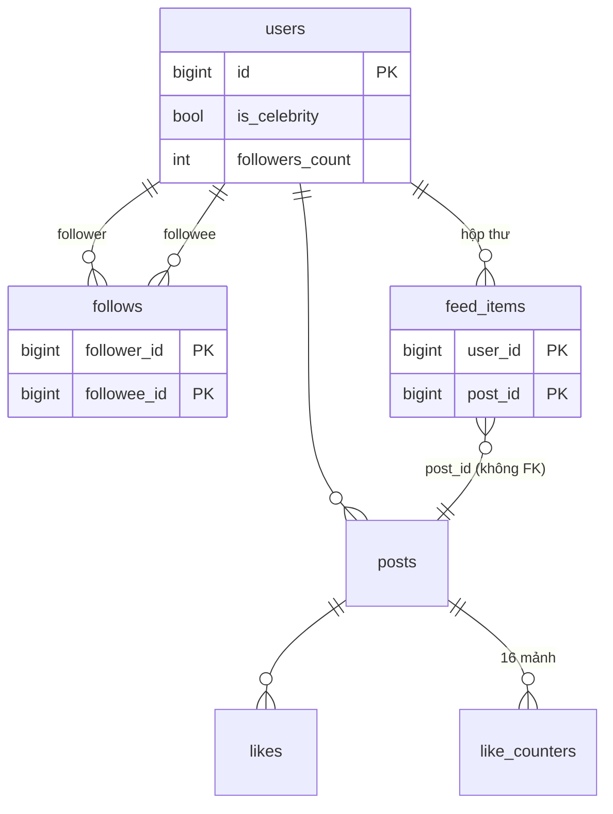
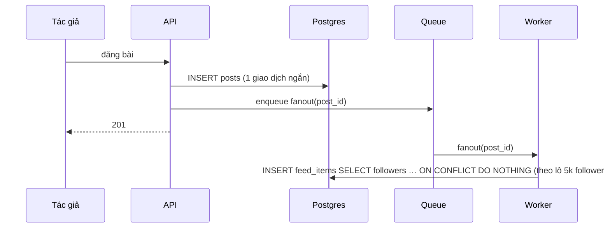

# D06 · Thiết kế tham chiếu (⚠️ spoiler)

Số đo: Postgres 18.6 Docker, `lab.d06` (100k user, 2.5M follow lệch mạnh, 300k bài, 476k dòng hộp thư). Đồ thị sinh để lệch: 7 "celebrity" (≥ 5000 follower, lớn nhất 53 863), trung bình 25 follower/user. Một user (id 100000) cố ý follow 2020 tài khoản. Máy cloud ≠ máy người học.

## 1. Requirements
Follow/unfollow; đăng bài; feed mới nhất 20 bài/trang, cuộn vô hạn; like idempotent với số đếm xấp xỉ; bài mới có trong feed ≤ 30 giây; celebrity tồn tại.

## 2. Access patterns
| # | Query | Loại | Tải |
|---|---|---|---|
| A1 | đăng bài (+ fan-out) | ghi | ~58/s TB, ~600/s đỉnh |
| A2 | đọc feed | đọc | ~2.9k/s TB (50:1 so với ghi) |
| A3 | like | ghi | rất nóng với bài viral |
| A4 | ai follow tôi / tôi follow ai | đọc | trung bình |

## 3. Ước lượng
- Đọc:ghi ≈ 50:1 ⇒ trả chi phí ở lúc ghi (push) để đọc rẻ, **trừ** tác giả có quá nhiều follower.
- Hộp thư: **85 B/dòng** (đo, PK + heap) × 5M bài × 150 follower = 750M dòng ≈ **64 GB/ngày** nếu fan-out cho mọi người. Chỉ fan-out cho user hoạt động (~25% = DAU) và giữ 7 ngày: ≈ 450 GB trạng thái ổn định. *Giả định số follower hoạt động; cần đo trên dữ liệu thật.*
- Write amplification đo trên seed: trung bình **23.6 dòng/bài** (471 732 dòng cho 20 000 bài), lớn nhất **4 689 dòng/bài** (tác giả thường đông follower nhất, ngay dưới ngưỡng 5000). Một celebrity 54k follower sẽ là 54k dòng/bài: lý do cần ngưỡng.
- `follows` 129 B/dòng (2 index) ⇒ 20M × 150 = 3B dòng ≈ 390 GB: lớn, shard theo `follower_id` + bảng đảo.

## 4. Data model

- `follows`: PK `(follower, followee)` trả lời "tôi follow ai" và chống trùng; index `(followee, follower)` cho "ai follow tôi" (fan-out, đếm).
- `posts.id` identity tăng dần: sắp xếp và keyset dùng `id`, không cần `created_at`.
- `feed_items` không FK: ghi rất nhiều, dòng mồ côi được lọc khi JOIN `posts` và dọn nền.
- Like: `likes` là sự thật (PK post,user ⇒ idempotent); `like_counters` 16 mảnh chỉ để đọc số nhanh.

## 5. Index & query
Cùng một người dùng (id 100000, follow 2020 tài khoản), feed 20 bài:

| Cách | Buffers | Ghi chú |
|---|---|---|
| Pull: `posts` có `author_id IN (followings)` ORDER BY id DESC LIMIT 20 | **9 600** | planner đi ngược `posts_pkey`, duyệt 3 179 bài rồi kiểm tra follow bằng Memoize; xấu đi khi follow ít người hoạt động |
| Pull, người bình thường follow 25 tài khoản (user 1, queries.sql §3) | **154** | Nested Loop qua `follows_pkey` rồi Bitmap trên `posts_author_idx` |
| Push: `feed_items` index scan ngược + join `posts` | **61** | không phụ thuộc số followings |
| Hybrid `feed_page` (user trên follow cả 7 celebrity) | **1 429** | phần pull celebrity chiếm hầu hết (LATERAL cho từng celebrity); vẫn rẻ hơn pull thuần 6.7× nhưng đắt hơn push thuần |

⇒ Pull rẻ cho người ít follow, phình theo số followings; push rẻ ổn định nhưng trả bằng write amplification. Hybrid có chi phí đọc tăng theo **số celebrity mình follow**, nên giới hạn `LIMIT` nhỏ trong LATERAL và cache danh sách celebrity bài mới.

- Keyset: `post_id < cursor ORDER BY post_id DESC LIMIT n`; trang 2 không trùng/sót (ASSERT §5). Không dùng OFFSET.
- `fanout_post` dùng `ON CONFLICT DO NOTHING`: chạy lại worker sau sự cố không nhân đôi (ASSERT §2).
- Unfollow: xóa khỏi `follows`; bài cũ của họ còn trong hộp thư ⇒ lọc lúc đọc bằng semi-join `follows` (đắt) hoặc xóa nền theo lô `DELETE FROM feed_items WHERE user_id = $1 AND post_id IN (posts của người bị unfollow)`. Chọn dọn nền, chấp nhận trễ vài phút (yêu cầu cho phép).

## 6. Kiến trúc
Fan-out bằng queue + worker (đăng bài trả lời ngay, feed trễ vài giây). Hộp thư chỉ cho follower **hoạt động 7 ngày**; người lâu không vào sẽ dựng feed bằng pull khi quay lại. Hộp thư có thể sống ở Redis (list/sorted set, ~800 mục) thay vì Postgres; Postgres giữ `follows`, `posts`, `likes`. Replica cho đọc feed.

## 7. Bottleneck & trade-off
**Thí nghiệm hot row (đo thật, `concurrency/run.sh`):** 50 client, 10 giây, mỗi giao dịch giữ row lock thêm 2 ms (mô phỏng việc khác trong transaction).

| Cách | TPS | Latency TB |
|---|---|---|
| 1 dòng counter | **287** | 174 ms |
| 16 mảnh, chọn ngẫu nhiên | **4 515** | 11 ms |

Thông lượng hot row ≈ 1 / thời gian giữ lock (≈ 1/2 ms ⇒ trần ~500/s; đo 287). Chia 16 mảnh được ~16× (4 515/287 = 15.7). Đọc số like = `SUM` 16 dòng (rẻ), hoặc cache.

| Vấn đề | Xử lý |
|---|---|
| Celebrity đăng bài | không fan-out; đọc theo pull; ngưỡng ~ vài chục nghìn follower, cấu hình được |
| Tác giả vượt ngưỡng | đổi cờ `is_celebrity`; hộp thư cũ vẫn dùng được, bài mới đi đường pull |
| Power user follow nhiều | giới hạn số followings hoạt động trong pull; ưu tiên push |
| `follows` 390 GB | shard theo `follower_id`; bảng `followers_of` phục vụ fan-out |
| `followers_count` | cập nhật theo lô/bất đồng bộ, không UPDATE mỗi lần follow |

| Mô hình | Đọc | Ghi | Điểm vỡ |
|---|---|---|---|
| Pull thuần | tăng theo số followings (154 → 9 600 buffers) | rẻ | power user, celebrity ít vấn đề |
| Push thuần | rẻ ổn định (61 buffers) | amplification (TB 23.6 dòng, tối đa 4 689 dòng / bài trong seed) | celebrity: hàng triệu dòng/bài |
| Hybrid (chọn) | push + pull celebrity | amplification có trần | phức tạp, đọc tăng theo số celebrity theo dõi |
