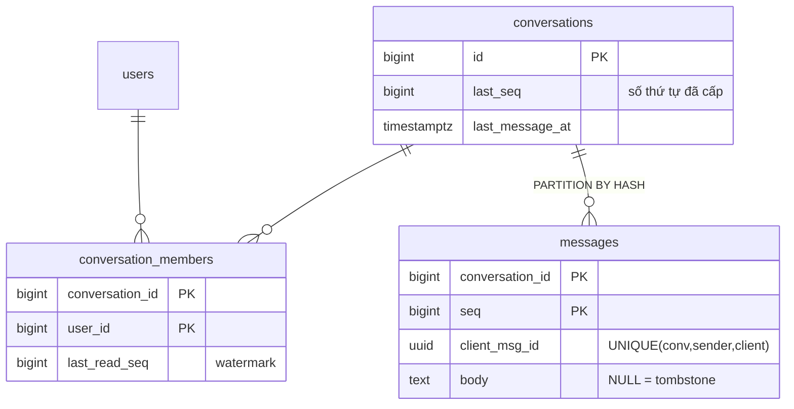

# D07 · Thiết kế tham chiếu (⚠️ spoiler)

Số đo: Postgres 18.6 Docker, `lab.d07` (20k hội thoại, 54.8k dòng thành viên, 1.22M tin, hash-partition 8). Hội thoại dài nhất 193 tin (seed nhỏ, nên các số "buffers" phải được đọc là *xu hướng*). Máy cloud ≠ máy người học.

## 1. Requirements
Chat 1-1 và nhóm ≤ 1000; thứ tự toàn phần trong hội thoại; unread count; cuộn lịch sử; gửi lại an toàn; xóa/sửa; giữ vĩnh viễn.

## 2. Access patterns
| # | Query | Loại | Tải |
|---|---|---|---|
| A1 | gửi tin | ghi | ~580/s TB, ~5k/s đỉnh |
| A2 | badge unread (từng hội thoại, tổng) | đọc | mỗi lần mở app |
| A3 | lịch sử theo trang | đọc | cao |
| A4 | danh sách hội thoại mới nhất | đọc | mỗi lần mở app |
| A5 | mark read | ghi | cao, nhẹ |

## 3. Ước lượng
- 50M tin/ngày ≈ 580/s TB, ~5k/s đỉnh. Một tin ⇒ ~3 câu lệnh (kiểm tra thành viên, UPDATE `last_seq`, INSERT, UPDATE read của người gửi) trong 1 transaction ngắn.
- Dung lượng: `messages` đo **177 B/tin** (heap + PK + UNIQUE client_msg_id) ⇒ 50M × 177 B ≈ **8.8 GB/ngày ≈ 3.2 TB/năm** (giả định body ngắn; tin dài/TOAST tăng thêm). Phải partition và có chiến lược tin lạnh.
- `conversation_members` 160 B/dòng: 2M user × 30 hội thoại = 60M dòng ≈ 9.6 GB: nằm gọn trong RAM của một máy vừa.
- Nhóm 1000 người: 1 tin = **1 dòng messages + 1 UPDATE conversations**, không phụ thuộc kích thước nhóm.

## 4. Data model

- **Một bản tin** cho cả nhóm; trạng thái đọc là *watermark* `last_read_seq` mỗi thành viên (không phải mỗi tin × mỗi người).
- `seq` cấp bằng `UPDATE conversations SET last_seq = last_seq + 1 … RETURNING` trong cùng transaction với INSERT: thứ tự toàn phần, **liên tục không lỗ** (thí nghiệm: 0 hội thoại lỗ/trùng sau 98k tin đồng thời). Sequence Postgres không dùng được vì nó cho phép lỗ khi rollback và là toàn cục.
- `client_msg_id` unique ⇒ gửi lại không tạo tin trùng (queries.sql §2).
- Xóa = tombstone (`body = NULL`), giữ seq, giữ chuỗi liên tục.
- Hash partition theo `conversation_id`: mọi query nóng có `conversation_id` ⇒ chỉ chạm một partition (history 5–6 buffers). *Hash không phân tách tin cũ/mới*; tin lạnh cần chiến lược khác (xem §7).

## 5. Index & query
| Query | Plan | Buffers (đo) |
|---|---|---|
| Lịch sử trang mới nhất | Index Scan Backward trên `messages_pN_pkey` | **5** |
| Trang cũ hơn (`seq < 100`) | cùng index | **6** |
| Unread tổng cho user 802 hội thoại, bằng `last_seq - last_read_seq` | Hash Join `members` ⋈ `conversations` | **257** |
| Cùng kết quả bằng đếm dòng `messages` | Parallel Seq Scan 8 partition | **12 614** (49×) và tăng theo lịch sử |
| Danh sách 20 hội thoại mới nhất, 802 hội thoại | Hash Join + top-N sort | **257** |

- Unread bằng watermark là O(số hội thoại), không phụ thuộc số tin; đếm dòng là O(số tin chưa đọc + lịch sử) và đo thấy 49× trên seed vài trăm tin/hội thoại. Với hội thoại hàng chục nghìn tin chênh lệch lớn hơn nhiều.
- Ở seed 20k hội thoại planner dùng Seq Scan `conversations` (241 buffers); với bảng lớn hơn nó chuyển sang Nested Loop theo PK. *Chưa đo ở 60M dòng.*
- Danh sách hội thoại: sort theo `conversations.last_message_at` sau join. Ổn tới vài nghìn hội thoại/user. Với power user lớn hơn, denormalize `last_message_at` vào `conversation_members` và index `(user_id, last_message_at DESC)`, đổi lấy một UPDATE mỗi thành viên mỗi tin (đắt với nhóm lớn: chỉ làm cho nhóm nhỏ).
- `mark_read` đơn điệu: `GREATEST(old, LEAST(upto, last_seq))` ⇒ chạy lại/đến trễ/sai thứ tự đều an toàn (§4).

```mermaid
sequenceDiagram
    participant C as Client
    participant G as Gateway
    participant P as Postgres
    C->>G: send(conv, client_msg_id, body)
    G->>P: BEGIN
    G->>P: kiểm tra membership; tìm client_msg_id cũ
    G->>P: UPDATE conversations SET last_seq=last_seq+1 RETURNING (lock hàng hội thoại)
    G->>P: INSERT messages(conv, seq…) ; UPDATE read của người gửi
    G->>P: COMMIT
    P-->>G: seq
    G-->>C: ack(seq)
    G-->>C: đẩy tin tới các thành viên online (WebSocket)
```

## 6. Kiến trúc
Gateway WebSocket giữ kết nối; DB không phải kênh đẩy. Sau COMMIT, gateway publish sự kiện `(conv, seq)` qua queue/pubsub (hoặc `NOTIFY` ở quy mô nhỏ) để các gateway khác đẩy tới thành viên online. Client offline lấy lại bằng "cho tôi các tin có `seq > last_known_seq`". Replica phục vụ lịch sử; nhưng đọc ngay sau khi gửi phải qua primary hoặc dựa vào ack.

## 7. Bottleneck & trade-off
**Thí nghiệm gửi đồng thời (đo thật, `concurrency/run.sh`):** 50 client, 10 giây.

| Kịch bản | TPS | Latency TB | Kiểm tra sau |
|---|---|---|---|
| Tất cả vào **1** hội thoại | **1 367** | 36.6 ms | 0 lỗ/trùng seq |
| Rải 20 000 hội thoại | **8 432** | 5.9 ms | 0 lỗ/trùng seq |

Một hội thoại bị chặn ~1.4k tin/s (hot row `last_seq`): đủ cho nhóm cực ồn (hàng nghìn người cùng gõ), nên không cần giải pháp đặc biệt; nếu cần hơn, chuyển sang seq theo lô do gateway cấp (một gateway sở hữu một hội thoại).

| Vấn đề | Xử lý |
|---|---|
| 3.2 TB/năm | partition theo thời gian *trong* mỗi hash (hash-then-range) hoặc chuyển tin > 90 ngày sang bảng/kho lạnh; truy vấn lịch sử cũ chấp nhận chậm hơn |
| Shard | theo `conversation_id`: thứ tự và unread nằm gọn trong một shard; danh sách hội thoại của user cần bảng chỉ mục theo user |
| Sửa tin | thêm bảng `message_edits` (append-only); `messages.body` giữ bản mới nhất |
| Tìm kiếm | giai đoạn 2: FTS/trigram trên partition nóng hoặc Elasticsearch |
| Đọc receipt "ai đã đọc" nhóm lớn | suy ra từ watermark: `count(*) FILTER (WHERE last_read_seq >= seq)` trên members (≤ 1000 dòng) |

| Cách đánh số thứ tự | Ưu | Nhược |
|---|---|---|
| `last_seq` theo hội thoại (chọn) | liên tục, unread O(1), phân trang theo seq | serialize gửi trong cùng hội thoại |
| Identity/sequence toàn cục | không hot row | có lỗ, unread phải đếm, thứ tự giữa hội thoại vô nghĩa |
| Snowflake/uuidv7 theo thời gian | phân tán dễ | thứ tự gần đúng (đồng hồ), unread phải đếm |
| `created_at` | đơn giản | trùng giá trị, lệch đồng hồ, không đảm bảo thứ tự |
