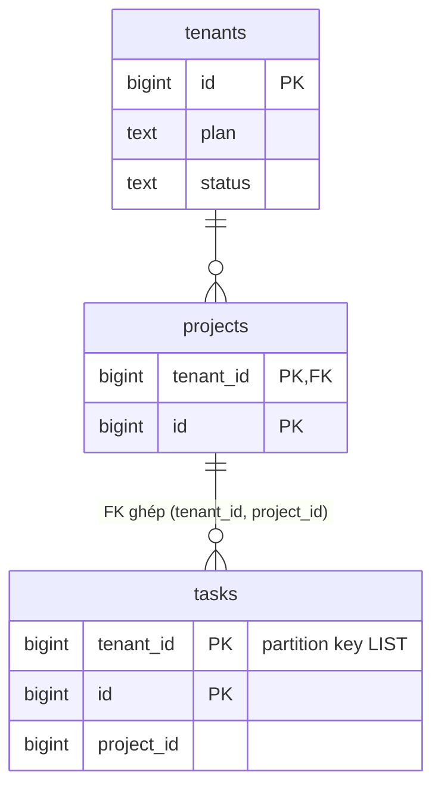
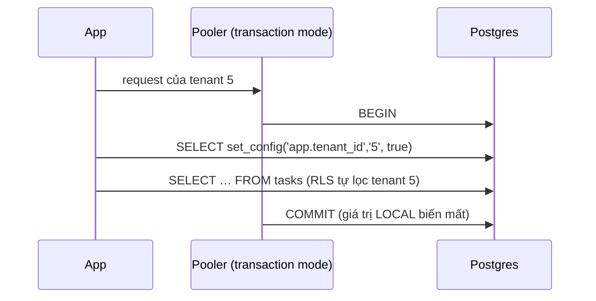
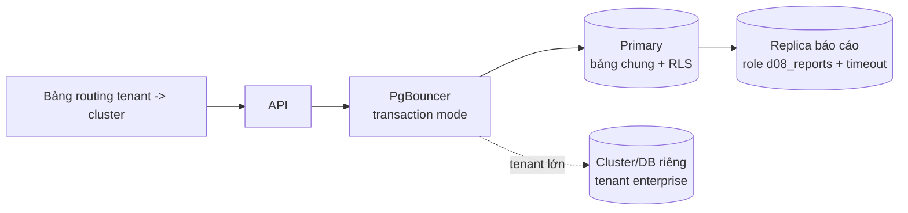

# D08 · Thiết kế tham chiếu (⚠️ spoiler)

Số đo: Postgres 18.6 Docker, máy **4 CPU**, `lab.d08` (1000 tenant, 1M task: tenant 1 = 400k, mỗi tenant khác 600). Đây là *tỉ lệ* chứ không phải quy mô thật (1 tỉ). Máy cloud ≠ máy người học.

## 1. Requirements
20k tenant, lệch mạnh; cách ly tuyệt đối; tenant nhỏ p99 < 200 ms; xóa tenant ≤ 30 ngày; migration 2 tuần/lần không downtime; có pooler.

## 2. Access patterns
| # | Query | Loại |
|---|---|---|
| A1 | 20 task mới nhất của tenant | đọc, nóng |
| A2 | đếm/liệt kê task theo project, trạng thái | đọc |
| A3 | báo cáo nặng toàn tenant | đọc nặng, nền |
| A4 | tạo/sửa task | ghi |
| A5 | xóa/xuất/chuyển tenant | vận hành |

## 3. Ước lượng
- Đo `tasks_rest` 103 MB / 599k dòng ≈ **180 B/dòng** (heap + PK + 2 index) ⇒ 1 tỉ dòng ≈ **180 GB** (giả định thật có thêm cột, nhân ~3 ⇒ ~0.5 TB). Một primary đủ; tenant top 10 giữ ~40% = ~70 GB mỗi 4 tenant.
- **Schema-per-tenant (đo thật):** 1000 schema × 2 bảng + 3 index (8 000 relation) ⇒ catalog tăng ~17 MB (32 → 49 MB cho `pg_class`+`pg_attribute`+`pg_index`, có thể gồm một ít bloat từ các lần chạy thử trước; 3.8 s để tạo). Nhân 20 lên 20k tenant: ~160k relation, ~340 MB catalog và `ALTER TABLE ADD COLUMN` chạy **333 ms/1000 ⇒ ~7 giây/20k lệnh DDL, mỗi lệnh lấy ACCESS EXCLUSIVE** (ngoại suy tuyến tính; chưa đo ở 20k). `pg_dump` và planner cache theo catalog chậm dần.
- Gộp 1000 schema trong **một** transaction thất bại `out of shared memory` (`max_locks_per_transaction` = 64): migration cần chia theo tenant.

## 4. Data model

- Mọi khóa chứa `tenant_id` đứng đầu. `tasks` có FK ghép `(tenant_id, project_id) → projects(tenant_id, id)`: task của tenant 5 **không thể** trỏ vào project của tenant 6 (§2 queries.sql), kể cả khi code sai hoặc bằng role quản trị (FK check bỏ qua RLS).
- **RLS + FORCE**: policy `tenant_id = current_setting('app.tenant_id', true)`. `true` ⇒ chưa đặt thì NULL ⇒ không dòng nào khớp (**fail closed**, §1). `WITH CHECK` chặn ghi chéo tenant (42501).
- Role `d08_app` không phải owner/superuser; **superuser và owner luôn bỏ qua RLS** (FORCE chỉ bắt owner thường, không bắt superuser/BYPASSRLS): kết nối ứng dụng bằng superuser vô hiệu hóa toàn bộ cách ly.
- `tasks PARTITION BY LIST (tenant_id)`: tenant khổng lồ có partition riêng (`tasks_t1`), phần còn lại vào `DEFAULT`. `promote_tenant()` chuyển tenant lên partition riêng.

## 5. Index & query
- **RLS không phá index.** Policy viết `(SELECT current_setting(...))` thành InitPlan, so với truy vấn có `WHERE tenant_id = 500` tường minh: **cùng Index Scan, cùng 23 buffers** (queries.sql §4). Partition `tasks_t1` được runtime-prune (`never executed`).  Bọc `(SELECT …)` để hàm chỉ chạy một lần (InitPlan) thay vì nguy cơ gọi lại theo từng dòng; *chưa đo biến thể không bọc*.
- **Plan lệch theo tenant** (§5): tenant 500 (400 dòng `open`): Bitmap Heap Scan, **406 buffers**. Tenant 1 (cá voi, 267k dòng `open`): Parallel Seq Scan trên `tasks_t1`, **4 028 buffers**. Cùng câu lệnh, hai plan, đúng cả hai. Với prepared statement dùng generic plan (`plan_cache_mode = force_generic_plan` hoặc sau 5 lần chạy), plan được chọn theo ước lượng *trung bình* nên một trong hai nhóm tenant sẽ dính plan xấu: dùng `plan_cache_mode = force_custom_plan` cho truy vấn nhạy cảm, hoặc partition riêng để mỗi partition có thống kê riêng. *Chưa đo riêng hiệu ứng generic plan trong bài này.*
- **Pooling**: `set_config('app.tenant_id', …, false)` (hoặc `SET` thường) sống sang request sau trên cùng connection ⇒ tenant A thấy dữ liệu tenant B. Luôn `SET LOCAL` / `set_config(…, true)` trong transaction (§3). Đây là lỗi cách ly phổ biến nhất của RLS.
- Báo cáo: `d08_reports` có `statement_timeout`. Truy vấn nặng của cá voi bị hủy với `57014 query_canceled`, truy vấn nhẹ của tenant nhỏ cùng role chạy bình thường (§6). Lưu ý `ALTER ROLE … SET` chỉ có hiệu lực khi role đăng nhập, không phải khi `SET ROLE`.

## 6. Kiến trúc

Lai: đuôi dài tenant nhỏ ở bảng chung + RLS; tenant vượt ngưỡng (kích thước hoặc hợp đồng) chuyển sang cluster/DB riêng, ứng dụng tra bảng routing. Báo cáo nặng đi replica.

## 7. Bottleneck & trade-off
**Noisy neighbor (đo thật, máy 4 CPU, 10 giây):**

| Kịch bản | Tenant nhỏ: TPS | Latency | Whale |
|---|---|---|---|
| 8 client tenant nhỏ, một mình | **10 925** | 0.73 ms | – |
| cùng lúc 4 client báo cáo cá voi (Parallel Seq Scan 400k dòng) | **4 186** (−62%) | 1.91 ms | 49 TPS, 82 ms |

Một tenant lớn làm tenant nhỏ chậm 2.6× chỉ vì tranh CPU (dữ liệu nằm trong RAM; trên đĩa còn tệ hơn). Giải pháp theo mức: `statement_timeout` theo role → pool/connection riêng cho báo cáo → replica báo cáo → tách tenant lớn ra cluster riêng.

**Xóa tenant 400k dòng (đo thật):**

| Cách | Thời gian | Hệ quả |
|---|---|---|
| `DELETE FROM tasks WHERE tenant_id = 9` | **167 ms** | 400k dead tuple ⇒ bloat, vacuum, WAL |
| `DETACH PARTITION` + `DROP TABLE` | **2.4 ms + 12 ms** | không bloat, không WAL dòng |

(Ở 200M dòng DELETE là hàng chục phút và tạo hàng chục GB WAL; số đó **chưa đo**, là ngoại suy tuyến tính từ 167 ms/400k ≈ 0.42 µs/dòng ≈ 84 s cho 200M ở điều kiện lý tưởng không tranh chấp: thực tế lâu hơn nhiều vì WAL/checkpoint/vacuum.)

| Mô hình cách ly | Ưu | Nhược |
|---|---|---|
| Bảng chung + RLS (chọn) | rẻ nhất, migration 1 lần, nhiều tenant nhỏ | cách ly logic, noisy neighbor, plan lệch, quên đặt tenant |
| Schema-per-tenant | cách ly mạnh hơn, xóa tenant = DROP SCHEMA | catalog phình (8 relation/tenant), migration N lần + lock, `max_locks_per_transaction`, pooler search_path |
| Database-per-tenant | cách ly mạnh nhất, backup/restore riêng | connection/tài nguyên mỗi DB, không join chéo, số tenant bị giới hạn |
| Cluster-per-tenant (enterprise) | cô lập hoàn toàn, SLA riêng | chi phí vận hành, chỉ đáng với tenant lớn |
