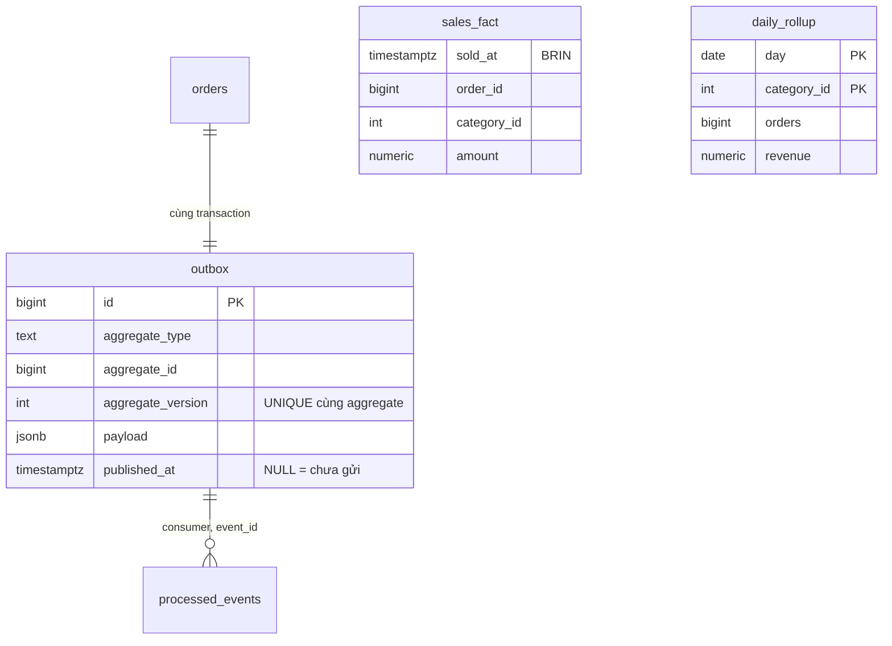
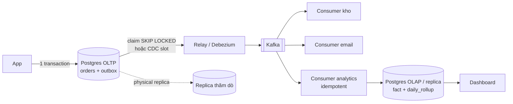

# D09 · Thiết kế tham chiếu (⚠️ spoiler)

Số đo: Postgres 18.6 Docker, máy 4 CPU, `lab.d09` (1M dòng fact = 65 MB, rollup 14 400 dòng). Thí nghiệm sự kiện (`concurrency/run.sh`) và CDC (`concurrency/cdc_demo.sh`, container tạm `wal_level=logical`). Máy cloud ≠ máy người học.

## 1. Requirements
Đặt hàng không bị chậm; dashboard doanh thu theo ngày × ngành hàng tươi ≤ 1 phút, 2 năm; kho/email/tìm kiếm phản ứng với đơn mới; không mất sự kiện; trùng thì chịu được; báo cáo theo giờ VN.

## 2. Access patterns
| # | Query | Loại |
|---|---|---|
| A1 | đặt đơn + phát sự kiện | ghi OLTP |
| A2 | relay lấy sự kiện chưa gửi | ghi nền |
| A3 | consumer áp sự kiện vào fact + rollup | ghi OLAP |
| A4 | dashboard 30 ngày × ngành hàng | đọc OLAP |
| A5 | truy vấn thăm dò tùy ý trên fact | đọc nặng |

## 3. Ước lượng
- 2M đơn/ngày × 2.5 dòng = 5M dòng fact/ngày ⇒ **1.8 tỉ dòng/năm**. Đo `sales_fact` = 65 MB/1M ≈ **68 B/dòng** (không tính index) ⇒ ~120 GB/năm. BRIN trên `sold_at`: **24 kB** cho 65 MB bảng.
- Dashboard quét thô: 30 ngày ≈ 10% bảng. Đo trên 1M dòng: Seq Scan = **8 336 buffers** (ngoại suy tuyến tính: ở 1.8 tỉ dòng thì cỡ 15 triệu buffers ≈ 120 GB đọc cho mỗi lần tải dashboard ⇒ không thể). Đọc `daily_rollup` cho cùng câu hỏi: **19 buffers**.
- Outbox: 20M sự kiện/ngày × ~300 B ≈ 6 GB/ngày nếu giữ; phải dọn: partition theo ngày + drop partition đã gửi.
- Relay 300 sự kiện/s đỉnh: một relay đủ (batch 100–1000).

## 4. Data model

- **Outbox**: `place_order()` ghi `orders` và `outbox` trong một transaction. Đơn lỗi ⇒ không có sự kiện (queries.sql §1). Không còn "ghi DB rồi publish": hai việc đó hoặc cùng xảy ra hoặc cùng không.
- `UNIQUE (aggregate_type, aggregate_id, aggregate_version)`: sự kiện của một aggregate có thứ tự; consumer bỏ qua bản có version ≤ đã thấy.
- **Rollup theo ngày nghiệp vụ giờ VN**: `(placed_at AT TIME ZONE 'Asia/Ho_Chi_Minh')::date`. Đơn 23:30 ngày 14/03 giờ VN vào ngày 14; đơn 00:30 ngày 15 giờ VN (17:30Z ngày 14) vào ngày 15, không phải ngày 14 (§4). Sự kiện đến trễ vẫn vào đúng ngày vì dùng `placed_at` trong payload, không dùng lúc nhận.
- Hủy/hoàn: phát sự kiện `OrderCancelled` với amount âm áp vào rollup (không UPDATE ngược). *Không dựng trong bài; thiết kế tương tự `apply_order_placed`.*

## 5. Index & query
- Relay: `claim_outbox(n)` = `UPDATE … WHERE id IN (SELECT … WHERE published_at IS NULL ORDER BY id LIMIT n FOR UPDATE SKIP LOCKED)`. Nhiều relay không giẫm nhau; chỉ thấy sự kiện của transaction **đã commit**. Partial index `outbox_pending_idx` chỉ chứa dòng chưa gửi. *Lưu ý (đo):* ngay sau khi gửi hết, plan vẫn là Bitmap Index Scan thấy 251 mục index nhưng 0 dòng sống: index chỉ dọn sau VACUUM ⇒ đặt autovacuum riêng cho `outbox` (scale_factor thấp) hoặc partition.
- Consumer: `apply_order_placed` chèn `processed_events (consumer, event_id) ON CONFLICT DO NOTHING` rồi mới cộng rollup; **phát lại toàn bộ 251 sự kiện lần hai: 251 bỏ qua, tổng không đổi** (§3).
- Dashboard (§5, cùng câu hỏi "doanh thu 30 ngày × ngành hàng"):

| Cách | Plan | Buffers |
|---|---|---|
| Quét `sales_fact`, không index | Seq Scan | **8 336** |
| BRIN **chưa summarize** (vừa nạp hàng loạt) | Bitmap Heap Scan, lossy 8 304 block | **8 309** (như không có index) |
| BRIN đã `VACUUM` | Bitmap Heap Scan, lossy 848 block | **853** (≈10×) |
| Đọc `daily_rollup` | Bitmap Index Scan trên PK | **19** (≈440× so với quét thô) |

- Tạo `MATERIALIZED VIEW mv_daily` + `REFRESH … CONCURRENTLY` cho kết quả **khớp từng ô** với rollup tăng dần (§6), nghĩa là rollup đúng. REFRESH đọc lại toàn bộ fact ⇒ O(kích thước fact) mỗi lần; rollup tăng dần là O(số sự kiện mới).

## 6. Kiến trúc

Ở 20M sự kiện/ngày, outbox-poll bằng Postgres đủ và rẻ vận hành (đội 3 người). CDC (Debezium) đáng khi cần độ trễ thấp hơn/giảm tải poll hoặc không muốn bảng outbox. OLAP có thể là một Postgres riêng (đến vài trăm GB/năm) trước khi cần kho cột.

## 7. Bottleneck & trade-off
**Thí nghiệm mất sự kiện (đo thật, `concurrency/run.sh`):** 16 writer, mỗi giao dịch giữ mở 0–20 ms ngẫu nhiên trước khi commit (làm đậm hiệu ứng), 8 giây, hai reader cùng theo dõi.

| Cách đọc | Đã ghi | Reader thấy | Mất |
|---|---|---|---|
| Poll `id > last_id` | 11 157 | 4 220 | **6 937 (62%)** |
| `published_at IS NULL … SKIP LOCKED` | 11 157 | 11 157 | **0** |

Nguyên nhân: id cấp lúc INSERT, commit sau; reader thấy id 10 đã commit, nhảy `last_id = 10`; id 7 commit sau đó nằm dưới `last_id` mãi mãi. Tỉ lệ mất phụ thuộc thời gian giữ transaction (ở đây cố tình lớn); transaction ngắn thì ít mất hơn nhưng **không bao giờ bằng 0**.

**Thí nghiệm CDC (đo thật, `cdc_demo.sh`, container tạm `wal_level=logical`):**
- Slot `test_decoding` đọc được INSERT/UPDATE của `outbox_demo` đúng thứ tự giao dịch (peek, chưa ack).
- Slot **không ai tiêu thụ** + ghi 1.5M dòng (~400 MB WAL): `pg_replication_slots` báo `wal_retained_by_slot = 390 MB`, thư mục WAL từ 16 MB lên **416 MB**. Sau khi drop slot và CHECKPOINT thư mục vẫn 416 MB vì segment chỉ được tái chế chứ không xóa tức thì. Nghĩa là consumer CDC chết 3 ngày với 6 GB/ngày ghi ⇒ giữ ~18 GB WAL, tới khi đầy đĩa nếu không đặt `max_slot_wal_keep_size` và cảnh báo trên `wal_status`/`restart_lsn`.

| Vấn đề | Xử lý |
|---|---|
| Outbox phình | partition theo ngày, drop partition cũ đã gửi; không `DELETE` hàng loạt |
| `processed_events` phình | khóa theo (consumer, event_id) rồi dọn theo cửa sổ (giữ N ngày > thời gian replay tối đa) |
| Backfill sai logic | tính lại rollup từ fact vào bảng mới rồi đổi tên; fact là nguồn sự thật |
| Consumer chậm | partition Kafka theo `aggregate_id` để giữ thứ tự mỗi đơn |
| Dashboard 2 năm | rollup theo ngày (~730 × 40 dòng) rất nhỏ; tháng/năm cộng từ rollup |

| Lựa chọn | Ưu | Nhược |
|---|---|---|
| Dual write | đơn giản | mất/phát nhầm khi hỏng giữa chừng |
| Outbox + poll (chọn) | đúng, ít hạ tầng | tải poll, độ trễ ≥ chu kỳ poll, phải dọn bảng |
| CDC logical decoding | độ trễ thấp, không bảng outbox cần poll | `wal_level=logical`, slot giữ WAL, vận hành Debezium/Kafka Connect |
| Rollup tăng dần | rẻ, tươi | cần idempotent + backfill |
| MV refresh toàn bộ | đơn giản, luôn đúng | O(fact) mỗi lần |
| Kho cột riêng | truy vấn tự do nhanh | thêm hệ thống, đồng bộ |
