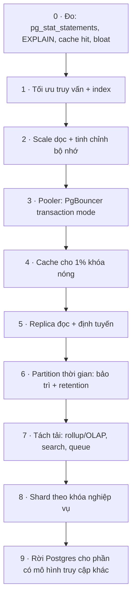
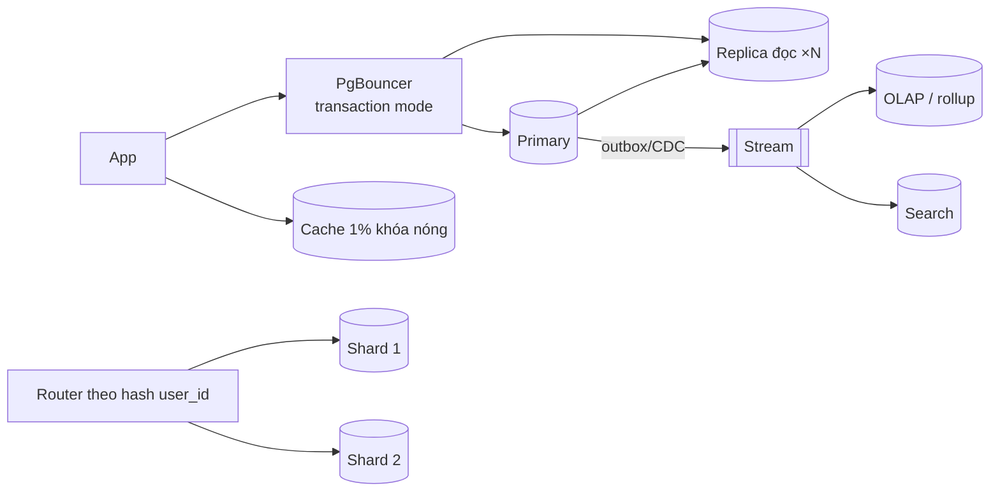

# D10 · Thiết kế tham chiếu (⚠️ spoiler)

Số đo: Postgres 18.6 Docker, máy **4 vCPU**, `shared_buffers = 256MB`, `max_connections = 100`; cloud, đĩa ảo. Mọi con số là *thứ tự độ lớn* để rút kết luận, không phải benchmark của phần cứng thật. **Citus không có trong image `postgres:18`, chưa chạy Citus**; phần shard dựng bằng `postgres_fdw` để thấy các nguyên lý (khóa shard, định tuyến, scatter-gather), không để đo hiệu năng của Citus.

## 1. Requirements
Từ 2k → 200k QPS (đọc-ghi trộn), 800 GB → 40 TB, ghi 5k → 500k dòng/s; read-your-writes sau khi sửa hồ sơ; thống kê trễ vài phút được; giao dịch tài chính trên `accounts`; đội 6 người.

## 2. Access patterns
| # | Query | Loại | Bậc scale chính |
|---|---|---|---|
| A1 | tra hồ sơ/khóa chính | đọc, 80% truy cập vào 1% khóa | cache + replica |
| A2 | sự kiện gần nhất của user | đọc theo khóa | index `(user_id, ts DESC)` |
| A3 | ghi sự kiện | ghi, append-only | partition thời gian, batching |
| A4 | thống kê theo ngày | đọc nặng | rollup / OLAP riêng (xem D09) |
| A5 | chuyển tiền giữa hai tài khoản | ghi, giao dịch | giữ trên một node/shard |

## 3. Ước lượng: trần một node (đo thật, `scripts/capacity.sh`, pgbench scale 50 = 5M dòng = 755 MB)
| Số connection | select-only TPS | TPC-B-like TPS |
|---|---|---|
| 1 | 13 047 | 1 107 |
| 4 (= số vCPU) | **106 498** | 3 225 |
| 16 | 72 047 | 6 768 |
| 64 | 67 466 | **7 109** |
| 256 | **không chạy được**: `FATAL: sorry, too many clients already` (`max_connections = 100`) | – |

Đọc bảng: (1) select-only đạt đỉnh khi số connection ≈ số core rồi **giảm** (106k → 67k) khi nhiều connection tranh CPU: pooler giữ số connection hoạt động gần số core. (2) Ghi (TPC-B có WAL fsync) chạm ~7k TPS ở 4 vCPU. (3) Connection vượt `max_connections` thì từ chối hẳn. Từ đó: 2k QPS → thừa sức; 200k QPS đọc điểm ≈ 2 node đọc cỡ 4 vCPU này (bỏ qua cache; máy 16 vCPU của khách có dư địa hơn nhưng chưa đo); 500k dòng/s ghi *không* làm được trên một node bằng giao dịch từng dòng (trần ~7k TPS ở đây; batch `COPY`/multi-row nâng lên hàng trăm nghìn dòng/s nhưng chưa đo) ⇒ cần batching, partition và có thể shard/queue.
Dung lượng: `events` 3M dòng = 396 MB (partition) ⇒ **~138 B/dòng**; 500k dòng/s × 86 400 s ≈ 43 tỉ dòng/ngày ≈ 6 TB/ngày: không thể giữ thô trong Postgres ⇒ retention ngắn + rollup, hoặc hệ lưu trữ khác (mục 7).

## 4. Data model & lộ trình theo bậc

| Bậc | Kích hoạt (ví dụ, cần hiệu chỉnh theo số đo của bạn) | Giá phải trả |
|---|---|---|
| 1 Tối ưu | luôn làm trước; top 5 query chiếm > 50% thời gian | thời gian kỹ sư |
| 2 Dọc | CPU > 60% bền vững hoặc dữ liệu nóng > RAM | giá tăng phi tuyến, trần phần cứng |
| 3 Pooler | connection hoạt động >> số core, hoặc gần `max_connections` | mất session state (SET, prepared, advisory lock) ở transaction mode |
| 4 Cache | phân bố lệch (xem mô hình dưới), đọc điểm là phần lớn tải | invalidation, hai nguồn sự thật, thundering herd |
| 5 Replica | đọc > ~70% tải và chịu được lag | lag, read-your-writes, xung đột truy vấn trên replica |
| 6 Partition | bảng append-only > vài trăm GB, cần retention | không tăng tốc truy vấn; khóa duy nhất phải chứa khóa phân vùng |
| 7 Tách tải | phân tích/tìm kiếm làm chậm OLTP | thêm hệ thống, đồng bộ (outbox/CDC: D09) |
| 8 Shard | ghi vượt trần một primary *đã đo*, hoặc dữ liệu vượt một máy | mất giao dịch/join xuyên shard, resharding, vận hành |
| 9 Rời Postgres | mô hình truy cập khác hẳn (cột, đồ thị, chuỗi thời gian, KV cực lớn) | di chuyển, mất SQL/transaction |

Mô hình `queries.sql`: `events` partition theo tháng (`ts`), `users` hash-partition 2 shard theo `user_id`.

## 5. Index & query (đo thật, `queries.sql`, `scripts/`)
**Partition thời gian không làm truy vấn nhanh hơn, nó làm bảo trì rẻ.**
- Truy vấn "một ngày" trên bảng partition (pruning về `events_2026_09` + BRIN): **345 buffers**. Cùng truy vấn trên bảng phẳng *có BRIN*: **355 buffers**. Không chênh lệch đáng kể. (Không có BRIN/index thì bảng phẳng Parallel Seq Scan ~25 000 buffers: khác biệt đến từ **index**, không từ partition.)
- Truy vấn không có khoảng thời gian ("sự kiện của user"): partition **27 buffers** (3 Bitmap Scan, một cho mỗi partition) so với phẳng **18 buffers**: nhiều partition ⇒ nhiều lần dò index. Với 1000 partition thì đắt hơn nhiều, đo trước khi tăng số partition.
- Retention (`scripts/retention.sql`), tháng cũ nhất ~1.03M dòng: `DELETE` bảng phẳng **450 ms** (và để lại dead tuple, file vẫn 425 MB cho tới khi vacuum/rewrite); `DETACH PARTITION` **2.6 ms** + `DROP TABLE` **87 ms**, giải phóng đĩa ngay. Giá trị thật của partition nằm ở đây.

**Shard theo khóa (postgres_fdw, 2 shard, 200k user, `scripts/shard_bench.sh`, 4 client):**

| Truy vấn | Chạm | TPS (3 lần chạy) | Latency TB |
|---|---|---|---|
| bảng thường 1 node, `WHERE user_id = ?` | – | 138 000–147 000 | 0.03 ms |
| bảng shard, `WHERE user_id = ?` (khóa shard) | **1 shard** (pruning, queries.sql §2) | 6 300–11 100 | 0.36–0.64 ms |
| bảng shard, `WHERE handle = ?` (không phải khóa shard) | **cả 2 shard** (§3) | 3 000–4 400 | 0.9–1.3 ms |

Thêm một hop mạng làm truy vấn điểm chậm ~12–22× ngay cả khi đúng shard (đây là localhost; mạng thật tệ hơn), và hỏi mọi shard chậm thêm ~1.5–3× với 2 shard: **tăng theo số shard**, độ trễ = shard chậm nhất. Sharding đổi thông lượng tổng lấy độ trễ từng truy vấn.
- **Aggregate xuyên shard (§4):** `GROUP BY country` với `enable_partitionwise_aggregate` bật hay tắt đều **kéo cả 200 000 dòng về router** (Foreign Scan rows=99 616 và 100 384): postgres_fdw không đẩy aggregate từng phần xuống shard khác nhau. Đây là lý do cần Citus hoặc tầng truy vấn phân tán thật. Kết quả hai cách giống nhau (ASSERT), chỉ khác chi phí.
- Index cục bộ: `handle` có index trên từng shard, nhưng **không có index toàn cục**: tìm theo `handle` vẫn phải hỏi mọi shard. Giải pháp: bảng phụ `handle → user_id` (tự chọn shard theo `handle`), chấp nhận hai ghi.
- Hash chia đều (99 616 vs 100 384, §1) khác range theo id (sẽ dồn người dùng mới vào một shard = hotspot).

## 6. Kiến trúc

**Cache (MÔ HÌNH, không phải đo; `queries.sql` §7):** với 1M khóa phân bố Zipf, giữ K khóa nóng nhất trong cache cho hit-rate:

| Độ lệch s | cache 0.1% khóa | 1% | 5% |
|---|---|---|---|
| 0.8 (lệch vừa) | 20.7% | 36.2% | 52.3% |
| 1.2 (lệch mạnh) | 82.2% | 91.0% | 95.1% |

"80% đọc vào 1% khóa" tương đương độ lệch mạnh (s ≳ 1.0–1.2): cache 1% đem lại hit ~90%, giảm tải DB ~10×. Nếu phân bố phẳng hơn (s = 0.8) cache 1% chỉ hit 36%: **phải đo phân bố thật trước khi dựa vào cache**.

**Replica đọc (đo thật, `scripts/replica_demo.sh`, 2 container, streaming async):**
- Dưới tải ghi 4 757 TPS (16 client, TPC-B): `replay_lag` tối đa **68 ms**, trung bình **7 ms**, chậm tối đa ~10 KB WAL. Lag nhỏ khi replica theo kịp, nhưng không bằng 0.
- Read-your-writes: ghi trên primary, COMMIT, đọc **ngay** trên replica (2 000 lần): **99.2% đọc thấy dữ liệu cũ** (1 983/2 000). Chờ 20 ms rồi đọc: **0.2%** (1/500). `synchronous_commit = remote_apply`: **0%** (0/2 000), latency mỗi cặp ghi+đọc 1.7 ms so với 0.96 ms (async). Số tuyệt đối thay đổi giữa các lần chạy; kết luận thì không: **đọc ngay sau ghi trên replica bất đồng bộ gần như luôn cũ**.
- Cách đảm bảo read-your-writes: (1) đọc primary trong N giây sau khi người dùng ghi (cookie/session), (2) lấy LSN lúc commit rồi chỉ đọc replica khi `pg_last_wal_replay_lsn() ≥ LSN`, (3) `remote_apply` cho giao dịch cần (đắt, chậm mọi commit nếu bật toàn cục).

## 7. Bottleneck & trade-off
| Vấn đề | Xử lý |
|---|---|
| Giao dịch xuyên shard (A5) | thiết kế để cả hai tài khoản cùng shard (khóa shard theo tổ chức/ví), hoặc saga với trạng thái trung gian. `postgres_fdw` commit từng server tuần tự, không 2PC mặc định ⇒ lỗi giữa chừng có thể để lệch. *Chưa tái hiện lỗi này.* |
| Resharding | bắt đầu với nhiều shard logic hơn node vật lý (vd. 64 logical → 4 node), di chuyển shard logic giữa node |
| Hotspot khóa shard | không dùng `created_at`/identity tăng dần làm khóa; dùng hash |
| Ghi 500k dòng/s sự kiện | batching `COPY`, đệm qua queue, retention ngắn, rollup; dữ liệu thô sang kho cột/object storage (mục 9) |
| Failover | Patroni/managed HA; RTO/RPO ghi vào hợp đồng; kiểm thử định kỳ (xem O06) |
| Backup 40 TB | WAL archiving + snapshot; thời gian restore là ràng buộc thiết kế |

**Khi nào rời Postgres:** phân tích tùy ý trên tỉ dòng (kho cột: ClickHouse/BigQuery), tìm kiếm toàn văn/vector quy mô lớn (search engine chuyên dụng), KV/session cực nóng (Redis), hàng đợi throughput cao (Kafka), chuỗi thời gian nén cao (TimescaleDB vẫn là Postgres, hoặc kho chuyên dụng), đồ thị sâu (graph DB). Tiêu chí: mô hình truy cập khác hẳn, *không phải* "Postgres chậm".

| Lựa chọn | Ưu | Nhược |
|---|---|---|
| Scale dọc | đơn giản nhất | trần cứng, giá tăng nhanh, một điểm lỗi |
| Replica đọc | tăng đọc gần tuyến tính | lag, read-your-writes, không tăng ghi |
| Partition | retention rẻ, bảo trì | không nhanh hơn, giới hạn khóa duy nhất |
| Shard (Citus/tự làm) | tăng ghi và dung lượng | mất join/transaction xuyên shard, vận hành khó |
| Rời Postgres | đúng công cụ cho đúng mô hình | thêm hệ thống, đồng bộ, mất SQL |
