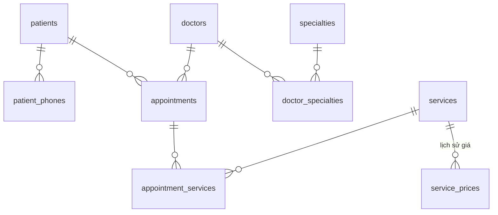

# R01 · ex09 · Thiết kế tham chiếu: phòng khám

DDL chạy được nằm ở `solutions/ex09.sql` (schema `r01_clinic`). Bài này không có đáp án duy nhất; dùng danh sách review bên dưới để chấm thiết kế của bạn.

## Các quyết định đáng chú ý
| Yêu cầu trong đề | Mô hình | Vì sao |
|---|---|---|
| Bệnh nhân có nhiều số điện thoại | `patient_phones` + unique index partial cho số chính | 1NF: đa trị không nhét vào một cột. Partial unique index đảm bảo ≤ 1 số chính |
| Bác sĩ có nhiều chuyên khoa | bảng nối `doctor_specialties`, PK ghép | nhiều-nhiều |
| Giá dịch vụ đổi theo thời gian | `service_prices(service_id, valid_from)` | lịch sử giá là dữ liệu, không ghi đè (xem R05 để làm chặt hơn bằng `daterange` + exclusion) |
| Hóa đơn phải đúng giá lúc khám | `appointment_services.charged_price` | **denormalize có chủ ý**: giá lúc bán là sự kiện lịch sử (xem ex07) |
| Trạng thái lịch hẹn | `text` + `CHECK (status IN …)` | đơn giản, đổi giá trị dễ hơn `enum`. Dùng bảng tra cứu nếu cần thêm thuộc tính cho trạng thái |
| Khóa | `bigint identity` cho bảng giao dịch; `smallint` cho bảng tra cứu nhỏ | surrogate key ổn định khi dữ liệu nghiệp vụ (tên, SĐT) đổi. Vẫn giữ `UNIQUE` trên khóa tự nhiên (`specialties.name`, `services.name`) |
| FK không tự có index | index `(patient_id, starts_at)`, `(doctor_id, starts_at)`, `service_id` | tra cứu lịch theo bệnh nhân/bác sĩ; xóa/cập nhật bảng cha không phải Seq Scan bảng con (ex10) |

## Danh sách review (tự chấm)
1. Mỗi bảng có PK? Mỗi cột đa trị đã tách bảng?
2. Mỗi thuộc tính phụ thuộc vào khóa, toàn bộ khóa, và không gì ngoài khóa (3NF)?
3. Có chỗ nào lưu cùng một sự thật ở hai nơi (tên bác sĩ trong `appointments`)? Nếu có, vì sao chấp nhận?
4. Mọi FK có index phía bảng con? `ON DELETE` đã chọn có chủ đích (CASCADE chỉ cho dữ liệu "thuộc về")?
5. Ràng buộc nghiệp vụ nào đã ép bằng database (CHECK, UNIQUE partial) thay vì chỉ trong code?
6. Kiểu dữ liệu: tiền `numeric`, thời điểm `timestamptz`, không dùng `float`/`varchar(n)` tùy tiện?
7. Còn thiếu: bác sĩ không được có 2 lịch hẹn trùng giờ → R08 (exclusion constraint).
