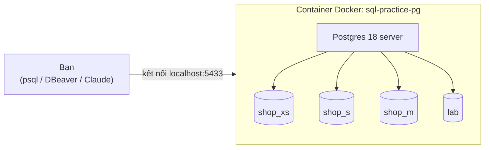

# S00 · Môi trường

## Sau buổi này bạn sẽ
- Hiểu mình đang làm việc với những gì: server Postgres, database, bảng, dòng, cột.
- Mở được `psql` và tự xem cấu trúc database.
- Chạy được câu SQL đầu tiên.
- Biết dùng `bench` để so một query ở nhiều quy mô.

## 1. Bức tranh tổng thể



- **Server**: một chương trình chạy liên tục và giữ dữ liệu. Server ở đây chạy trong một container Docker.
- **Database**: một kho dữ liệu độc lập. Server này có nhiều database: `shop_xs`, `shop_s`, `shop_m`, `lab`…
- **Table (bảng)**: giống một sheet Excel có cấu trúc chặt chẽ. Mỗi **cột** có kiểu dữ liệu cố định, mỗi **dòng** là một bản ghi.
- **Client**: chương trình bạn dùng để gửi câu SQL tới server, rồi nhận kết quả về. Ví dụ: `psql`, DBeaver.

## 2. Mở psql

Mở **PowerShell** hoặc **Windows Terminal**. Không dùng Git Bash, vì Git Bash cần thêm `winpty`.

```powershell
docker exec -it sql-practice-pg psql -U postgres -d shop_s
```

Thấy dấu nhắc `shop_s=#` là đã vào được. Gõ `\q` để thoát.

> Nếu tiếng Việt hiển thị lỗi font, chạy `chcp 65001` trước rồi vào lại psql.

## 3. Lệnh của psql (bắt đầu bằng `\`, KHÔNG phải SQL, không cần `;`)

| Lệnh | Tác dụng |
|---|---|
| `\l` | Liệt kê các database |
| `\c shop_m` | Chuyển sang database khác |
| `\dt` | Liệt kê các bảng |
| `\d orders` | Xem cấu trúc bảng: cột, kiểu, ràng buộc, index |
| `\d+ orders` | Như trên, thêm dung lượng và mô tả |
| `\x` | Bật/tắt hiển thị dọc. Dùng khi bảng có nhiều cột, quá rộng |
| `\timing` | Bật/tắt hiển thị thời gian chạy mỗi câu |
| `\e` | Mở trình soạn thảo để viết câu SQL dài |
| `\i file.sql` | Chạy một file SQL (đường dẫn bên trong container) |
| `\?` / `\h SELECT` | Trợ giúp lệnh psql / cú pháp SQL |
| `\q` | Thoát |

**Câu SQL phải kết thúc bằng `;`.** Nếu quên, psql sẽ chờ bạn gõ tiếp (dấu nhắc đổi thành `shop_s-#`). Khi đó chỉ cần gõ `;` rồi Enter.

## 4. GUI (tùy chọn)
DBeaver / pgAdmin / TablePlus kết nối với thông số: host `localhost`, port **`5433`**, user `postgres`, password `postgres`, database `shop_s`.

> **DBeaver báo `FATAL: invalid value for parameter "TimeZone": "Asia/Saigon"`?**
> JDBC driver gửi múi giờ của Java (`Asia/Saigon`, tên cũ) lên server. Image `postgres:18` (Debian 13) chỉ còn tên mới là `Asia/Ho_Chi_Minh`.
> Cách sửa: mở `dbeaver.ini` (thường ở `C:\Program Files\DBeaver\`, cần quyền admin) và thêm dòng `-Duser.timezone=UTC` vào **sau** dòng `-vmargs`, rồi khởi động lại DBeaver.
> Nên dùng `UTC` để giờ hiển thị trong DBeaver khớp với psql và với kết quả kỳ vọng trong các bài.

## 5. Dataset
Xem `datasets/shop/README.md` để biết ERD và ý nghĩa từng bảng. **Đừng mở `DIRTY.md`**: đó là danh sách lỗi cài sẵn, bạn sẽ tự phát hiện dần trong các bài sau.

## 6. Bench: một query, nhiều quy mô

```bash
bench/bench.sh <file.sql> --scales xs,s,m
```
Kết quả mẫu nằm ở `bench/results/`. Cùng một query, thời gian chạy tăng từ 0.2ms lên 563ms khi dữ liệu tăng từ 100 lên 1M đơn. Từ Tier I trở đi, bạn sẽ phải **dự đoán** trước những con số này, rồi mới chạy để kiểm chứng.

---

## ✍️ Việc của bạn (khoảng 15 phút)

Làm trong psql, sau đó dán kết quả hoặc trả lời vào chat:

1. Gõ `\l`. Có bao nhiêu database có tên bắt đầu bằng `shop_`?
2. `\c shop_s` rồi `\dt`. Có bao nhiêu bảng? Kể tên.
3. `\d orders`. Cột `status` có kiểu gì? Phần **Check constraints** cho phép những giá trị nào?
4. Chạy câu SQL đầu tiên của bạn:
   ```sql
   SELECT * FROM categories;
   ```
   Có bao nhiêu dòng? Những danh mục nào có `parent_id` để trống (NULL)?
5. Bật `\timing`, sau đó chạy `SELECT count(*) FROM events;` lần lượt trên `shop_s` và `shop_m` (đổi DB bằng `\c`). Ghi lại hai thời gian chạy. Theo bạn, vì sao chúng chênh nhau nhiều như vậy?
